# Restaurant Management System — Architectural Blueprint & Decisions Log

---

## 1. Enums (Fixed Compiler-Safe Constants)
- **`DietaryType`**: `VEG`, `NON_VEG`, `VEGAN`
- **`Department`**: `KITCHEN`, `SERVICE`
- **`Permission`**: `TAKE_ORDER`, `PREPARE_FOOD`, `APPROVE_RECIPE`, `GENERATE_BILL`, `VOID_BILL`
- **`Unit`**: 
  - Mass: `GRAM` (base: 1.0), `KILOGRAM` (1000.0)
  - Volume: `MILLILITER` (base: 1.0), `LITER` (1000.0), `TEASPOON` (5.0), `TABLESPOON` (15.0), `CUP` (240.0)
  - Count: `PIECE` (1.0), `PINCH` (0.5)

---

## 2. Value Objects (Immutable, Identity by Value)
- **`RecipeIngredient`** (Flyweight Context Object):
  - `Ingredient ingredient`: Points to the shared master inventory `Ingredient` (Intrinsic state).
  - `double amount`: Contextual quantity in this specific recipe (Extrinsic state).
  - `Unit unit`: Contextual recipe unit (e.g. `TABLESPOON`).
  - `getBaseAmount()`: Converts contextual amount to the ingredient's base inventory unit (`amount * unit.getConversionFactor()`).
  - *Pattern Applied*: **Flyweight Pattern** — eliminates duplicate ingredient instances across 100+ recipes while centralizing inventory in a single master `Ingredient`.

---

## 3. Entities (Mutable, Identity by ID)

### Staff & Master Data
- **`Cuisine`**: `id`, `name`, `isActive`
- **`Role`**: `id`, `name`, `department`, `Set<Permission> permissions`
- **`Employee`**: `id`, `name`, `email`, `phoneNumber`, `department`, `role`
  - Helper: `hasPermission(Permission p)`

### Inventory & Culinary
- **`Ingredient`** (Inventory Master):
  - `id`: String
  - `name`: String
  - `baseUnit`: Unit (e.g. `MILLILITER` for oil, `GRAM` for cheese)
  - `availableQuantity`: double
  - `deductStock(double baseAmount)`: Decrements inventory when dishes are prepared.
- **`Recipe`**:
  - `id`: String
  - `instructions`: List<String>
  - `prepTimeMinutes`: int
  - `cookTimeMinutes`: int
  - `recipeIngredients`: List<RecipeIngredient>
- **`Dish`** (Pure Culinary Definition):
  - `id`: String
  - `name`: String
  - `description`: String
  - `dietaryType`: DietaryType
  - `cuisine`: Cuisine
  - `recipe`: Recipe
  - *Note*: Dish has zero price awareness. Price is contextual to where and when it is sold.

### Commercial Menu Architecture (Decoupled & Multi-Menu Ready)
- **`Course`** (Master Category Entity):
  - `id`: String
  - `name`: String (e.g. *"Soups"*, *"Appetizers"*, *"Main Course"*, *"Desserts"*)
- **`MenuItem`** (Commercial Offering):
  - `id`: String
  - `dish`: Dish (reference to master culinary dish)
  - `price`: BigDecimal (menu-specific commercial pricing)
  - `isAvailable`: boolean (toggled off if kitchen runs out of stock)
- **`MenuCourse`** (Menu-to-Course Bridge Entity):
  - `id`: String
  - `course`: Course (reference to master course)
  - `isActive`: boolean (allows turning off whole courses, e.g. breakfast cut-off at 11 AM)
  - `displayOrder`: int
  - `items`: List<MenuItem>
- **`Menu`** (Aggregate Catalog):
  - `id`: String
  - `name`: String (e.g. *"Dine-in Dinner Menu"*, *"Brunch Menu"*)
  - `menuCourses`: List<MenuCourse>

---

## 4. Customization & Recipe Assembly (Decorator Pattern)
To prevent combinatorial explosion ($4 \times 4 \times 3 = 48$ variants), customizable orders dynamically decorate the base item:

- **`PreparedItem`** (Component Interface):
  - `getPrice()`: BigDecimal
  - `getDietaryType()`: DietaryType
  - `getIngredients()`: List<RecipeIngredient>
  - `getCookingInstructions()`: List<String>
- **`BaseDishItem`** (Concrete Component):
  - Wraps base `MenuItem` and its `Dish` recipe.
- **`DishModifierDecorator`** (Abstract Decorator):
  - Implements `PreparedItem`, wraps another `PreparedItem`.
  - Concrete subclasses: `ProteinDecorator` (adds protein ingredient, overrides dietary type to `NON_VEG`), `SauceDecorator` (adds sauce ingredient and simmering instruction), `AddOnDecorator` (e.g. extra cheese).
- *Trade-off / Kink watch*: In pure in-memory OOP, Decorator is clean and dynamic. In relational DB persistence, it maps to an `OrderItem` holding a `List<SelectedModifier>`. We support both cleanly.

---

## 5. Universal Order & Multi-Channel Architecture

The **`Order`** is the universal payload consumed by the kitchen and Kitchen Display System (KDS), regardless of channel.

### Enums
- **`OrderChannel`**: `DINE_IN`, `TAKEAWAY`, `DELIVERY`
- **`OrderStatus`**: `RECEIVED`, `PREPARING`, `READY`, `SERVED`, `DISPATCHED`, `CANCELLED`
- **`ReservationStatus`**: `CONFIRMED`, `SEATED`, `CANCELLED`, `NO_SHOW`
- **`SessionStatus`**: `ACTIVE`, `BILLED`, `SETTLED`, `CANCELLED`
- **`BillStatus`**: `UNPAID`, `PAID`, `REFUNDED`
- **`PaymentMethod`**: `CASH`, `CREDIT_CARD`, `DEBIT_CARD`, `UPI`

### Channel Contexts
- **`Order`** (Universal Aggregate):
  - `id`: String
  - `channel`: OrderChannel
  - `items`: List<OrderItem>
  - `placedAt`: LocalDateTime
  - `status`: OrderStatus
  - Channel Metadata:
    - If `DINE_IN`: links to `sessionId`, `tableNumber`, `waiter`
    - If `TAKEAWAY`: links to `pickupToken`, `customerPhone`
    - If `DELIVERY`: links to `deliveryAddress`, `customerPhone`, `riderDetails`

- **`OrderItem`**:
  - `item`: PreparedItem (Base Dish + Decorated Modifiers)
  - `quantity`: int
  - `specialInstructions`: String
  - `subtotal`: BigDecimal (`item.getPrice() * quantity`)

---

## 6. Reservation & In-House Dining Session (State Pattern)

### Reservation Domain (Future Booking Subdomain)
- **`Reservation`**:
  - `id`: String
  - `customer`: Customer
  - `tableNumber`: String
  - `partySize`: int
  - `reservedSlot`: LocalDateTime
  - `status`: ReservationStatus
  - `checkIn()`: Transitions status to `SEATED` and spawns a new active `DiningSession`.

### In-House Dining Session (Multi-Round Visit)
- **`DiningSession`**:
  - `sessionId`: String
  - `tableNumber`: String
  - `primaryCustomer`: Customer
  - `partyMembers`: List<Customer>
  - `assignedWaiter`: Employee
  - `orders`: List<Order> (Holds all multi-round dine-in orders placed during the visit)
  - `status`: SessionStatus (`ACTIVE` -> `BILLED` -> `SETTLED`)
  - Invariant: `addOrder()` is only permitted while status is `ACTIVE`. Cannot add orders once billed or settled.

---

## 7. Billing Engine (Split-Payment Support)
- **`Payment`**:
  - `paymentId`: String
  - `amount`: BigDecimal
  - `method`: PaymentMethod (`CASH`, `CREDIT_CARD`, `DEBIT_CARD`, `UPI`)
  - `transactionReference`: String
  - `paidAt`: LocalDateTime
- **`Bill`**:
  - `billId`: String
  - `sessionId`: String
  - `itemSubtotal`: BigDecimal
  - `taxAmount`: BigDecimal
  - `serviceCharge`: BigDecimal
  - `discountAmount`: BigDecimal
  - `totalPayable`: BigDecimal
  - `billStatus`: BillStatus (`UNPAID`, `PARTIALLY_PAID`, `PAID`)
  - `payments`: List<Payment>
  - `addPayment(Payment payment)`: Records a partial or full payment.
  - `getRemainingAmount()`: `totalPayable - sum(payments)`.
  - `isFullyPaid()`: Returns true when remaining amount is zero.
- **`BillingStrategy`** (Strategy Interface):
  - `computeBill(List<Order> orders)`: BillBreakdown
  - Concrete: `StandardRestaurantBillingStrategy` (Configurable Tax % + Service Charge % with `BigDecimal` half-up rounding).

---

## 8. Complete System Mermaid Class Diagram

```mermaid
classDiagram
    direction TB

    %% Enums
    class CuisineType {
        <<enumeration>>
        ITALIAN
        FRENCH
        CHINESE
        JAPANESE
        INDIAN
        CONTINENTAL
    }

    class DietaryType {
        <<enumeration>>
        VEG
        NON_VEG
        VEGAN
    }

    class Department {
        <<enumeration>>
        KITCHEN
        SERVICE
    }

    class Permission {
        <<enumeration>>
        TAKE_ORDER
        PREPARE_FOOD
        APPROVE_RECIPE
        GENERATE_BILL
        VOID_BILL
    }

    class Unit {
        <<enumeration>>
        GRAM
        KILOGRAM
        MILLILITER
        LITER
        TEASPOON
        TABLESPOON
        CUP
        PIECE
        PINCH
        +getConversionFactor() double
    }

    class OrderChannel {
        <<enumeration>>
        DINE_IN
        TAKEAWAY
        DELIVERY
    }

    class OrderStatus {
        <<enumeration>>
        RECEIVED
        PREPARING
        READY
        SERVED
        CANCELLED
    }

    class SessionStatus {
        <<enumeration>>
        ACTIVE
        BILLED
        SETTLED
        CANCELLED
    }

    class BillStatus {
        <<enumeration>>
        UNPAID
        PARTIALLY_PAID
        PAID
    }

    class PaymentMethod {
        <<enumeration>>
        CASH
        CREDIT_CARD
        DEBIT_CARD
        UPI
    }

    %% Value Objects
    class Address {
        <<value object>>
        -street: String
        -city: String
        -state: String
        -postalCode: String
        -country: String
        +getFormattedAddress() String
    }

    class RecipeIngredient {
        <<value object>>
        -ingredient: Ingredient
        -amount: double
        -unit: Unit
        +getBaseAmount() double
    }

    %% Staff & RBAC
    class Employee {
        <<abstract>>
        #id: String
        #name: String
        #email: String
        #phoneNumber: String
        #department: Department
        #role: Role
        +hasPermission(Permission permission) boolean
    }

    class Role {
        -id: String
        -name: String
        -department: Department
        -permissions: Set~Permission~
        +hasPermission(Permission permission) boolean
    }

    class Waiter {
        -assignedTables: List~String~
        +takeOrder(DiningSession session, Order order) void
        +requestBill(DiningSession session) Bill
    }

    class Chef {
        +prepareOrder(Order order) void
        +consultRecipe(Dish dish) Recipe
    }

    Employee <|-- Waiter
    Employee <|-- Chef
    Employee o-- Role
    Employee --> Department
    Role o-- Permission

    %% Inventory & Recipes
    class Ingredient {
        -id: String
        -name: String
        -baseUnit: Unit
        -availableQuantity: double
        +deductStock(double amount) void
    }

    class Recipe {
        -id: String
        -instructions: List~String~
        -prepTimeMinutes: int
        -cookTimeMinutes: int
        -ingredients: List~RecipeIngredient~
        +getIngredients() List~RecipeIngredient~
    }

    RecipeIngredient o-- Ingredient
    RecipeIngredient --> Unit
    Recipe *-- "1..*" RecipeIngredient

    %% Catalog & Decoupled Menu
    class Cuisine {
        -id: String
        -name: String
        -isActive: boolean
    }

    class Course {
        -id: String
        -name: String
    }

    class Dish {
        -id: String
        -name: String
        -description: String
        -dietaryType: DietaryType
        -cuisine: Cuisine
        -recipe: Recipe
        +getRecipe() Recipe
    }

    class MenuItem {
        -id: String
        -dish: Dish
        -price: BigDecimal
        -isAvailable: boolean
        +getPrice() BigDecimal
    }

    class MenuCourse {
        -id: String
        -course: Course
        -isActive: boolean
        -displayOrder: int
        -items: List~MenuItem~
        +getItems() List~MenuItem~
    }

    class Menu {
        -id: String
        -name: String
        -menuCourses: List~MenuCourse~
        +findItemById(String menuItemId) Optional~MenuItem~
    }

    Dish --> DietaryType
    Dish o-- Cuisine
    Dish *-- Recipe
    MenuItem o-- Dish
    MenuCourse o-- Course
    MenuCourse *-- "1..*" MenuItem
    Menu *-- "1..*" MenuCourse

    %% Customization & Decorator Pattern
    class PreparedItem {
        <<interface>>
        +getPrice() BigDecimal
        +getDietaryType() DietaryType
        +getIngredients() List~RecipeIngredient~
        +getCookingInstructions() List~String~
    }

    class BaseDishItem {
        -menuItem: MenuItem
        +getPrice() BigDecimal
        +getDietaryType() DietaryType
        +getIngredients() List~RecipeIngredient~
        +getCookingInstructions() List~String~
    }

    class DishModifierDecorator {
        <<abstract>>
        #wrappedItem: PreparedItem
        +getPrice() BigDecimal
        +getDietaryType() DietaryType
        +getIngredients() List~RecipeIngredient~
        +getCookingInstructions() List~String~
    }

    PreparedItem <|.. BaseDishItem
    PreparedItem <|.. DishModifierDecorator
    DishModifierDecorator o-- PreparedItem

    %% Ordering, Sessions & Visits
    class Customer {
        -id: String
        -name: String
        -phoneNumber: String
        +getId() String
        +getName() String
    }

    class OrderItem {
        -orderItemId: String
        -item: PreparedItem
        -quantity: int
        -specialInstructions: String
        +getSubtotal() BigDecimal
    }

    class Order {
        -id: String
        -channel: OrderChannel
        -placedAt: LocalDateTime
        -status: OrderStatus
        -items: List~OrderItem~
        +calculateSubtotal() BigDecimal
        +updateStatus(OrderStatus newStatus) void
    }

    class Reservation {
        -id: String
        -customer: Customer
        -tableNumber: String
        -partySize: int
        -reservedSlot: LocalDateTime
        -status: ReservationStatus
        +checkIn() DiningSession
    }

    class DiningSession {
        -sessionId: String
        -tableNumber: String
        -primaryCustomer: Customer
        -partyMembers: List~Customer~
        -assignedWaiter: Waiter
        -status: SessionStatus
        -orders: List~Order~
        -bill: Bill
        +addOrder(Order order) void
        +generateBill(BillingStrategy strategy) Bill
        +settleSession(PaymentMethod method, String ref) void
    }

    OrderItem o-- PreparedItem
    Order *-- "1..*" OrderItem
    Order --> OrderChannel
    Order --> OrderStatus
    Reservation o-- Customer
    DiningSession o-- Customer
    DiningSession o-- Waiter
    DiningSession *-- "1..*" Order : "Multi-round orders during visit"
    DiningSession --> SessionStatus

    %% Billing
    class Payment {
        -paymentId: String
        -amount: BigDecimal
        -method: PaymentMethod
        -transactionReference: String
        -paidAt: LocalDateTime
        +getAmount() BigDecimal
    }

    class Bill {
        -billId: String
        -sessionId: String
        -itemSubtotal: BigDecimal
        -taxAmount: BigDecimal
        -serviceCharge: BigDecimal
        -totalPayable: BigDecimal
        -billStatus: BillStatus
        -payments: List~Payment~
        +addPayment(Payment payment) void
        +getRemainingAmount() BigDecimal
        +isFullyPaid() boolean
    }

    class BillingStrategy {
        <<interface>>
        +computeBill(List~Order~ orders) Bill
    }

    DiningSession *-- "0..1" Bill
    DiningSession ..> BillingStrategy
    Bill *-- "0..*" Payment : "Split payments (Cash + UPI + Card)"
    Payment --> PaymentMethod
    Bill --> BillStatus

    %% Top-Level Restaurant Aggregate
    class Restaurant {
        -name: String
        -address: Address
        -cuisines: Set~Cuisine~
        -menu: Menu
        -employees: List~Employee~
        -activeSessions: Map~String, DiningSession~
        +startSession(String tableNumber, Customer customer, Waiter waiter) DiningSession
    }

    Restaurant *-- Address
    Restaurant o-- Cuisine
    Restaurant *-- Menu
    Restaurant o-- Employee
    Restaurant o-- DiningSession
```

