# Restaurant Management System — Architectural Blueprint & Decisions Log

---

## 1. Core Requirements & Domain Model Alignment

The design directly models the real-world operational domain of an enterprise restaurant while strictly adhering to the requirements:

1. **Restaurant**: Root aggregate composing `name`, `address`, `cuisines`, `menu`, `waiters`, `chefs`, `tables`, and `activeVisits`.
2. **Cuisines**: Explicit compiler-safe constants via `CuisineType` (`ITALIAN`, `FRENCH`, `CHINESE`, `JAPANESE`, `INDIAN`, `CONTINENTAL`, `MEXICAN`).
3. **Menu Structure**: `Menu` aggregates `MenuSection`s (`Soups`, `Appetizers`, `Pastas & Mains`, `Desserts`). Each section contains master `Dish` entities.
4. **Dish Definition**: Each `Dish` defines culinary identity: `name`, `description`, `type` (`VEG`, `NON_VEG`, `VEGAN`), `price`, `targetStation`, and `recipe`.
5. **Recipe & Ingredients**: A `Recipe` defines cooking instructions, prep time, and itemized `RecipeIngredient`s.
6. **Ingredient Measurement**:
   - **Solids** are strictly measured in **`MeasurementUnit.GRAMS`**.
   - **Liquids / Semi-liquids** are strictly measured in **`MeasurementUnit.MILLILITERS`**.
   - Enforced via `IngredientType` (`SOLID` vs `LIQUID`).
7. **Staff Levels**:
   - **`Waiter`**: Has `WaiterLevel` (`JUNIOR`, `SENIOR`, `MANAGER`) and dynamic table assignments.
   - **`Chef`**: Has `ChefLevel` (`COMMIS_CHEF`, `SOUS_CHEF`, `HEAD_CHEF`, `EXECUTIVE_CHEF`) and primary `KitchenStation`.
8. **Customer Visit Lifecycle**: Tracks customers across their dining visit via `CustomerVisit`. Supports multi-round ordering (`Round 1: Appetizers`, `Round 2: Mains`) and terminal bill generation.

---

## 2. Gang of Four (GoF) Design Patterns Applied

### 1. Strategy Pattern (`com.restaurant.billing.strategy`)
- **Problem**: Tax laws (GST/VAT), service fees, and promotional discounts vary across restaurant branches and dining programs.
- **Solution**: Encapsulate calculation algorithms behind `BillingStrategy`:
  - `StandardBillingStrategy`: Computes standard statutory tax and service charges.
  - `DiscountedBillingStrategy`: Applies promotional/loyalty percentage discounts before computing taxes.
- **Benefits**: Extensible for new pricing models (e.g., HappyHour, CorporateVoucher) without modifying `CustomerVisit` or `Bill`.

### 2. Observer Pattern (`com.restaurant.event`)
- **Problem**: When orders are placed, disparate downstream consumers need real-time notifications: kitchen station display screens, guest table notifications, and billing audit logs.
- **Solution**: Decouple publishers from subscribers via `OrderEventPublisher` and `OrderEventListener`:
  - `KitchenDisplayListener`: Routes orders to specific station screens (`HOT_KITCHEN`, `COLD_STATION`, `BAR`).
  - `CustomerNotificationListener`: Dispatches alerts to guests.
  - `KitchenAuditLogListener`: Maintains an immutable audit trail of state transitions.

### 3. Decorator Pattern (`com.restaurant.customization`)
- **Problem**: Customizing dishes (e.g. adding extra cheese, changing spice intensity, adding chicken/shrimp) creates combinatorial explosion if modeled via class inheritance ($4 \times 4 \times 3 = 48$ subclasses).
- **Solution**:
  - `OrderableItem`: Common component interface declaring `getName()`, `getPrice()`, `getDietaryType()`.
  - `BaseDishItem`: Wraps base `Dish`.
  - `DishCustomizationDecorator`: Abstract decorator wrapping an `OrderableItem`.
  - Concrete decorators: `ExtraToppingDecorator`, `SpiceLevelDecorator`, and `ProteinDecorator` (which dynamically switches `DietaryType` to `NON_VEG`).

### 4. State Pattern (`com.restaurant.model.CustomerVisit`)
- **Problem**: Ordering and billing operations must occur in strict sequence during a visit.
- **Solution**: State machine lifecycle:
  $$\text{ACTIVE} \xrightarrow{\text{generateBill()}} \text{BILLED} \xrightarrow{\text{makePayment() (all settled)}} \text{COMPLETED}$$
- Enforces invariant guards:
  - Cannot place orders after billing is initiated.
  - Cannot complete visit with an unpaid balance.
  - Frees table and releases assigned waiter automatically upon completion.

### 5. Builder Pattern (`com.restaurant.builder`)
- **Problem**: Assembling multi-layered aggregates (`Recipe`, `Menu`, `Restaurant`) involves numerous nested dependencies.
- **Solution**: `RestaurantBuilder`, `MenuBuilder`, and `RecipeBuilder` provide fluent, step-by-step assembly with fail-fast invariant validation.

---

## 3. Class Blueprint & Type Contracts

```mermaid
classDiagram
    direction TB

    %% Enums
    class CuisineType {
        <<enumeration>>
        ITALIAN
        FRENCH
        CHINESE
        JAPANESE
        INDIAN
        CONTINENTAL
        MEXICAN
    }

    class DietaryType {
        <<enumeration>>
        VEG
        NON_VEG
        VEGAN
    }

    class IngredientType {
        <<enumeration>>
        SOLID
        LIQUID
    }

    class MeasurementUnit {
        <<enumeration>>
        GRAMS
        MILLILITERS
    }

    class WaiterLevel {
        <<enumeration>>
        JUNIOR
        SENIOR
        MANAGER
    }

    class ChefLevel {
        <<enumeration>>
        COMMIS_CHEF
        SOUS_CHEF
        HEAD_CHEF
        EXECUTIVE_CHEF
    }

    class KitchenStation {
        <<enumeration>>
        HOT_KITCHEN
        COLD_STATION
        BAR
        DESSERT_STATION
    }

    class OrderStatus {
        <<enumeration>>
        PLACED
        PREPARING
        READY
        SERVED
        CANCELLED
    }

    class VisitStatus {
        <<enumeration>>
        ACTIVE
        BILLED
        COMPLETED
        CANCELLED
    }

    class BillStatus {
        <<enumeration>>
        UNPAID
        PARTIALLY_PAID
        PAID
        REFUNDED
    }

    class PaymentMethod {
        <<enumeration>>
        CASH
        CREDIT_CARD
        DEBIT_CARD
        UPI
    }

    %% Value Objects & Models
    class Address {
        -String street
        -String city
        -String state
        -String postalCode
        +getFormattedAddress() String
    }

    class Customer {
        -String id
        -String name
        -String phoneNumber
        -String email
    }

    class Table {
        -String tableNumber
        -int capacity
        -boolean isOccupied
        +markOccupied() void
        +markAvailable() void
    }

    class Ingredient {
        -String id
        -String name
        -IngredientType type
        -MeasurementUnit unit
        -double currentStock
        +addStock(double amount) void
        +deductStock(double amount) void
    }

    class RecipeIngredient {
        -Ingredient ingredient
        -double amount
        -MeasurementUnit unit
    }

    class Recipe {
        -String id
        -List~String~ instructions
        -int prepTimeMinutes
        -List~RecipeIngredient~ ingredients
    }

    class Dish {
        -String id
        -String name
        -String description
        -DietaryType type
        -double price
        -Recipe recipe
        -KitchenStation targetStation
        -boolean isAvailable
    }

    class MenuSection {
        -String sectionName
        -List~Dish~ dishes
        +addDish(Dish dish) void
        +findDishByName(String name) Optional~Dish~
    }

    class Menu {
        -String menuId
        -String name
        -List~MenuSection~ sections
        +addSection(MenuSection section) void
        +findDishByName(String name) Optional~Dish~
    }

    %% Staff
    class Employee {
        <<abstract>>
        #String id
        #String name
        #String email
        #String phoneNumber
    }

    class Waiter {
        -WaiterLevel level
        -List~Table~ assignedTables
        +assignTable(Table table) void
        +releaseTable(Table table) void
    }

    class Chef {
        -ChefLevel level
        -KitchenStation primaryStation
    }

    Employee <|-- Waiter
    Employee <|-- Chef
    Waiter --> WaiterLevel
    Chef --> ChefLevel
    Chef --> KitchenStation

    %% Customization / Decorator Pattern
    class OrderableItem {
        <<interface>>
        +getName() String
        +getPrice() double
        +getDietaryType() DietaryType
    }

    class BaseDishItem {
        -Dish dish
        +getName() String
        +getPrice() double
        +getDietaryType() DietaryType
    }

    class DishCustomizationDecorator {
        <<abstract>>
        #OrderableItem wrappedItem
        +getName() String
        +getPrice() double
        +getDietaryType() DietaryType
    }

    class ExtraToppingDecorator {
        -String toppingName
        -double additionalCost
    }

    class SpiceLevelDecorator {
        -String spiceLevel
    }

    class ProteinDecorator {
        -String proteinName
        -double additionalCost
    }

    OrderableItem <|.. BaseDishItem
    OrderableItem <|.. DishCustomizationDecorator
    DishCustomizationDecorator <|-- ExtraToppingDecorator
    DishCustomizationDecorator <|-- SpiceLevelDecorator
    DishCustomizationDecorator <|-- ProteinDecorator
    DishCustomizationDecorator o-- OrderableItem

    %% Ordering & Visit
    class OrderItem {
        -String itemId
        -OrderableItem item
        -int quantity
        -String specialInstructions
        +getSubtotal() double
    }

    class Order {
        -String orderId
        -List~OrderItem~ items
        -OrderStatus status
        -long placedTimestamp
        +addItem(OrderItem item) void
        +updateStatus(OrderStatus status) void
        +calculateSubtotal() double
    }

    class CustomerVisit {
        -String visitId
        -Table table
        -Customer customer
        -Waiter waiter
        -List~Order~ orders
        -Bill bill
        -VisitStatus status
        +placeOrder(Order order) void
        +generateBill(BillingStrategy strategy) Bill
        +makePayment(Payment payment) void
        +completeVisit() void
    }

    OrderItem o-- OrderableItem
    Order *-- "1..*" OrderItem
    CustomerVisit o-- Table
    CustomerVisit o-- Customer
    CustomerVisit o-- Waiter
    CustomerVisit *-- "1..*" Order

    %% Billing & Split Payment
    class Payment {
        -String paymentId
        -double amount
        -PaymentMethod method
        -String transactionReference
        -long timestamp
    }

    class Bill {
        -String billId
        -double itemSubtotal
        -double taxAmount
        -double serviceCharge
        -double discountAmount
        -double totalPayable
        -BillStatus status
        -List~Payment~ payments
        +addPayment(Payment payment) void
        +getRemainingAmount() double
        +isFullyPaid() boolean
    }

    class BillingStrategy {
        <<interface>>
        +calculateBill(String billId, List~Order~ orders) Bill
    }

    class StandardBillingStrategy {
        -double taxRate
        -double serviceChargeRate
    }

    class DiscountedBillingStrategy {
        -double taxRate
        -double serviceChargeRate
        -double discountPercent
    }

    BillingStrategy <|.. StandardBillingStrategy
    BillingStrategy <|.. DiscountedBillingStrategy
    CustomerVisit *-- "0..1" Bill
    CustomerVisit ..> BillingStrategy
    Bill *-- "0..*" Payment

    %% Event Bus / Observer Pattern
    class OrderEvent {
        <<abstract>>
        -String eventId
        -long timestamp
    }

    class OrderPlacedEvent {
        -CustomerVisit visit
        -Order order
    }

    class OrderStatusChangedEvent {
        -Order order
        -OrderStatus previousStatus
        -OrderStatus newStatus
    }

    class OrderEventListener {
        <<interface>>
        +onOrderPlaced(OrderPlacedEvent event) void
        +onOrderStatusChanged(OrderStatusChangedEvent event) void
    }

    class OrderEventPublisher {
        -List~OrderEventListener~ listeners
        +subscribe(OrderEventListener listener) void
        +unsubscribe(OrderEventListener listener) void
        +publishOrderPlaced(OrderPlacedEvent event) void
        +publishStatusChanged(OrderStatusChangedEvent event) void
    }

    OrderEvent <|-- OrderPlacedEvent
    OrderEvent <|-- OrderStatusChangedEvent
    OrderEventPublisher o-- "0..*" OrderEventListener

    %% Restaurant Aggregate Root
    class Restaurant {
        -String name
        -Address address
        -List~CuisineType~ cuisines
        -Menu menu
        -List~Waiter~ waiters
        -List~Chef~ chefs
        -List~Table~ tables
        -VisitManager visitManager
        -KitchenService kitchenService
        +hostGuest(Customer customer, Table table, Waiter waiter) CustomerVisit
        +placeOrder(String visitId, Order order) void
        +generateBill(String visitId, BillingStrategy strategy) Bill
    }

    Restaurant *-- Address
    Restaurant *-- Menu
    Restaurant o-- "1..*" Waiter
    Restaurant o-- "1..*" Chef
    Restaurant *-- "1..*" Table
```

