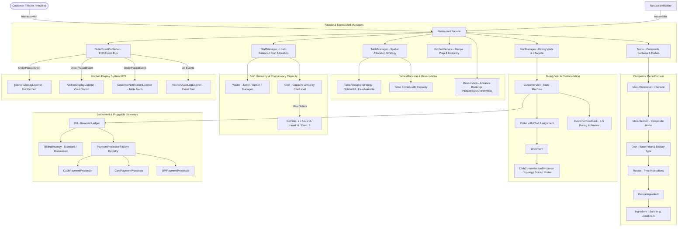

# Restaurant Management System — Low-Level Design (LLD)

[](https://openjdk.org/projects/jdk/21/)
[](pom.xml)
[](src/test/java/com/restaurant)
[](RestaurantDesign.md)

A production-grade, object-oriented Low-Level Design (LLD) and Machine Coding implementation of an enterprise **Restaurant Management System** in Java 21, built to the exact standards of [`ParkingLotLLDDesign`](https://github.com/aniagra119/ParkingLotLLDDesign) and [`ElevatorLLDDesign`](https://github.com/aniagra119/ElevatorLLDDesign). Adheres strictly to clean architecture, SOLID principles, and Gang of Four (GoF) design patterns.

---

## 1. System Requirements & Domain Mapping

| # | Requirement in Problem | Implementation Details | Design Pattern / Component |
| :---: | :--- | :--- | :--- |
| **1** | **Restaurant Aggregate** | High-level coordinator delegating to dedicated managers (`StaffManager`, `TableManager`, `VisitManager`). | `Restaurant` (**Facade Pattern**) |
| **2** | **Cuisines** | Strongly-typed cuisine classifications (`Italian`, `French`, `Chinese`, `Japanese`, `Indian`, `Continental`, `Mexican`). | `CuisineType` (Enum) |
| **3** | **Menu & Composite Hierarchy** | Uniform treatment of entire menus and sections via `MenuComponent` composite interface (`Soups`, `Appetizers`, `Pastas & Mains`). | `MenuComponent`, `Menu`, `MenuSection` (**Composite Pattern**) |
| **4** | **Dish & Price** | Dish defines name, description, dietary type (`VEG`, `NON_VEG`, `VEGAN`), price, target kitchen station, and recipe. | `Dish`, `DietaryType` |
| **5** | **Recipe & Ingredients** | Recipe details cooking instructions, prep time, and itemized ingredients. | `Recipe`, `RecipeIngredient` |
| **6** | **Ingredient Measurements** | Strict physical distinction between **Solids measured in GRAMS** and **Liquids measured in MILLILITERS**. | `Ingredient`, `IngredientType`, `MeasurementUnit` |
| **7** | **Waiter Hierarchy & Load Balancing** | Waiter levels (`Junior`, `Senior`, `Manager`) with automatic least-loaded table assignment. | `Waiter`, `WaiterLevel`, `StaffManager` |
| **8** | **Chef Hierarchy & Concurrency Capacity** | Chef levels (`Commis: 2`, `Sous: 4`, `Head: 6`, `Executive: 3`) with active order capacity limits. | `Chef`, `ChefLevel`, `KitchenStation` |
| **9** | **Customizable Dishes** | Dynamic decoration for add-on toppings, spice levels, and protein additions without combinatorial class explosion. | `OrderableItem`, `BaseDishItem`, `DishCustomizationDecorator` (**Decorator Pattern**) |
| **10**| **Table Allocation Strategy** | Pluggable table discovery heuristics (e.g. `OptimalFitAllocationStrategy` minimizing empty covers). | `TableManager`, `TableAllocationStrategy` (**Strategy Pattern**) |
| **11**| **Customer Visit Lifecycle** | Tracks dining guests across multi-round orders during their visit (`Round 1: Starters`, `Round 2: Mains`). | `CustomerVisit`, `Order`, `OrderItem` (**State Machine**) |
| **12**| **Pre-Visit Reservations** | Table booking lifecycle (`PENDING`, `CONFIRMED`, `CANCELLED`, `COMPLETED`, `NO_SHOW`) before seating. | `Reservation`, `ReservationStatus` |
| **13**| **Post-Visit Feedback** | Post-visit customer reviews with clamped 1–5 ratings and feedback comments. | `CustomerFeedback` |
| **14**| **Kitchen Display System (KDS)** | Observer bus routing order tickets to station displays (`HOT_KITCHEN`, `COLD_STATION`, `BAR`, `DESSERT_STATION`). | `OrderEventPublisher`, `KitchenDisplayListener` (**Observer Pattern**) |
| **15**| **Kitchen Inventory Depletion** | Concurrency-safe atomic deduction of raw ingredient stocks upon kitchen order preparation. | `KitchenService`, `Ingredient.deductStock()` |
| **16**| **Itemized Billing & Strategies** | Configurable tax and service charge calculations with promotional/loyalty discount strategies. | `BillingStrategy`, `StandardBillingStrategy`, `DiscountedBillingStrategy` (**Strategy Pattern**) |
| **17**| **Payment Gateway Abstraction** | Decoupled payment processing SPI with pluggable processors (`Cash`, `Card`, `UPI`) and registry factory. | `PaymentProcessor`, `PaymentProcessorFactory` (**Registry / Factory Pattern**) |
| **18**| **Split Payment Support** | Supports partial split payments across multiple payment methods (`CASH`, `UPI`, `CREDIT_CARD`, `DEBIT_CARD`). | `Bill`, `Payment`, `BillStatus` (`UNPAID` $\to$ `PARTIALLY_PAID` $\to$ `PAID`) |
| **19**| **Common Entity Foundation** | Abstract base entity tracking unique IDs, creation timestamps, and mutation timestamps. | `BaseEntity` |
| **20**| **Fluent Construction** | Step-by-step restaurant, menu, and recipe assembly. | `RestaurantBuilder`, `MenuBuilder`, `RecipeBuilder` (**Builder Pattern**) |

---

## 2. High-Level Architecture Topology



---

## 3. Package & Directory Structure

```
src/main/java/com/restaurant
├── Restaurant.java                                 # Facade Coordinator (Strict SRP)
├── builder/
│   ├── MenuBuilder.java                            # Fluent menu assembly
│   ├── RecipeBuilder.java                          # Fluent recipe assembly
│   └── RestaurantBuilder.java                      # Fluent restaurant assembly
├── enums/
│   ├── BillStatus.java                             # UNPAID, PARTIALLY_PAID, PAID, REFUNDED
│   ├── ChefLevel.java                              # COMMIS_CHEF, SOUS_CHEF, HEAD_CHEF, EXECUTIVE_CHEF
│   ├── CuisineType.java                            # ITALIAN, FRENCH, CHINESE, INDIAN, etc.
│   ├── DietaryType.java                            # VEG, NON_VEG, VEGAN
│   ├── IngredientType.java                         # SOLID, LIQUID
│   ├── KitchenStation.java                         # HOT_KITCHEN, COLD_STATION, BAR, DESSERT_STATION
│   ├── MeasurementUnit.java                        # GRAMS (solids), MILLILITERS (liquids)
│   ├── OrderStatus.java                            # PLACED, PREPARING, READY, SERVED, CANCELLED
│   ├── PaymentMethod.java                          # CASH, CREDIT_CARD, DEBIT_CARD, UPI
│   ├── ReservationStatus.java                      # PENDING, CONFIRMED, CANCELLED, COMPLETED, NO_SHOW
│   ├── VisitStatus.java                            # ACTIVE, BILLED, COMPLETED, CANCELLED
│   └── WaiterLevel.java                            # JUNIOR, SENIOR, MANAGER
├── exception/
│   ├── InsufficientInventoryException.java         # Raised on raw stock depletion
│   ├── InvalidPaymentException.java                # Raised on overpayment or invalid transaction
│   ├── InvalidVisitStateException.java             # Raised on out-of-order visit state transitions
│   └── TableAlreadyOccupiedException.java          # Raised on double-booking tables
├── model/
│   ├── Address.java                                # Immutable postal address Value Object
│   ├── BaseEntity.java                             # Common ID, createdAt, updatedAt foundation
│   ├── Chef.java                                   # Chef entity with capacity limits by level
│   ├── Customer.java                               # Dining customer entity
│   ├── CustomerFeedback.java                       # Post-visit review with clamped rating (1-5)
│   ├── CustomerVisit.java                          # Dining visit aggregate managing multi-round orders
│   ├── Dish.java                                   # Master dish with price, dietary type, and recipe
│   ├── Employee.java                               # Abstract base employee entity
│   ├── Ingredient.java                             # Raw inventory stock item (solid in g, liquid in ml)
│   ├── Menu.java                                   # Composite root menu
│   ├── MenuComponent.java                          # Composite interface for menu hierarchy
│   ├── MenuSection.java                            # Composite section holding list of dishes
│   ├── Order.java                                  # Order round aggregate with chef assignment
│   ├── OrderItem.java                              # Line item with quantity and customizations
│   ├── Recipe.java                                 # Cooking instructions and required ingredients
│   ├── RecipeIngredient.java                       # Contextual quantity and unit for a recipe
│   ├── Reservation.java                            # Pre-visit booking entity
│   ├── Table.java                                  # Dining table entity with capacity and status
│   └── Waiter.java                                 # Waiter entity with WaiterLevel and table assignments
├── customization/
│   ├── BaseDishItem.java                           # Concrete component wrapping base Dish
│   ├── DishCustomizationDecorator.java             # Abstract decorator for orderable items
│   ├── ExtraToppingDecorator.java                  # Decorator adding toppings (e.g. Parmesan, Olives)
│   ├── OrderableItem.java                          # Component interface for pricing and dietary type
│   ├── ProteinDecorator.java                       # Decorator adding protein and switching dietary type
│   └── SpiceLevelDecorator.java                    # Decorator modifying dish spice intensity
├── billing/
│   ├── Bill.java                                   # Itemized bill with split-payment ledger
│   ├── Payment.java                                # Immutable payment transaction record
│   └── strategy/
│       ├── BillingStrategy.java                    # Financial calculation strategy interface
│       ├── DiscountedBillingStrategy.java          # Promotional / loyalty discount calculations
│       └── StandardBillingStrategy.java            # Standard tax + service charge calculations
├── payment/
│   ├── PaymentProcessor.java                       # Payment gateway SPI abstraction
│   ├── PaymentProcessorFactory.java                # Registry Factory for payment processors
│   ├── PaymentResult.java                          # Gateway response value object
│   └── processor/
│       ├── CardPaymentProcessor.java               # Credit / Debit card processor
│       ├── CashPaymentProcessor.java               # Physical cash transaction processor
│       └── UPIPaymentProcessor.java                # Instant QR / UPI processor
├── strategy/
│   └── table/
│       ├── FirstAvailableAllocationStrategy.java   # First available table matching capacity
│       ├── OptimalFitAllocationStrategy.java       # Minimizes wasted covers by finding tightest fit
│       └── TableAllocationStrategy.java            # Pluggable table discovery strategy
├── event/
│   ├── OrderEvent.java                             # Abstract base order event
│   ├── OrderPlacedEvent.java                       # Event dispatched when an order is placed
│   ├── OrderStatusChangedEvent.java                # Event dispatched on order state advancement
│   ├── OrderEventListener.java                     # Observer listener interface
│   ├── OrderEventPublisher.java                    # Synchronous event bus dispatcher
│   └── listener/
│       ├── CustomerNotificationListener.java       # Table alert listener
│       ├── KitchenAuditLogListener.java            # Comprehensive audit trail listener
│       └── KitchenDisplayListener.java             # KDS station screen listener
└── service/
    ├── KitchenService.java                         # Order preparation, stock deduction, and status routing
    ├── StaffManager.java                           # Load-balanced waiter assignment and chef directory
    ├── TableManager.java                           # Table discovery, capacity filtering, and strategy manager
    └── VisitManager.java                           # Thread-safe dining visit manager and table tracker
```

---

## 4. Key Design Patterns Implemented

### 1. Strategy Pattern (x2)
- **Billing Strategy** (`BillingStrategy`): Decouples financial algorithms (standard tax, service fee, loyalty discounts) from visit lifecycle (`StandardBillingStrategy` vs `DiscountedBillingStrategy`).
- **Table Allocation Strategy** (`TableAllocationStrategy`): Dynamically swaps spatial allocation heuristics (`OptimalFitAllocationStrategy` minimizing wasted capacity vs `FirstAvailableAllocationStrategy`).

### 2. Observer Pattern (Kitchen Display System Event Bus)
- Decouples order placement from peripheral kitchen display systems.
- When `VisitManager.placeOrder()` is called, `OrderPlacedEvent` is published to `OrderEventPublisher`.
- `KitchenDisplayListener` routes the order to the appropriate station display (`HOT_KITCHEN`, `COLD_STATION`, `BAR`).
- `CustomerNotificationListener` and `KitchenAuditLogListener` independently receive updates without tight coupling.

### 3. Decorator Pattern (Customizable Dishes)
- Solves combinatorial class explosion for dish customizations ($4 \text{ proteins} \times 4 \text{ toppings} \times 3 \text{ spice levels} = 48\text{ variants}$).
- `OrderableItem` is the component interface implemented by `BaseDishItem`.
- `DishCustomizationDecorator` wraps an `OrderableItem`, allowing dynamic wrapping with `ExtraToppingDecorator`, `SpiceLevelDecorator`, and `ProteinDecorator` (which switches `DietaryType` dynamically).

### 4. Composite Pattern (Uniform Menu Hierarchy)
- `MenuComponent` interface treats individual sections (`MenuSection`) and full menus (`Menu`) uniformly.
- Enables uniform dish discovery (`getAllDishes()`) and recursive hierarchical display (`display(indentLevel)`).

### 5. Registry / Factory Pattern (Payment Gateway SPI)
- `PaymentProcessorFactory` maintains a thread-safe registry mapping `PaymentMethod` to decoupled `PaymentProcessor` implementations (`CashPaymentProcessor`, `CardPaymentProcessor`, `UPIPaymentProcessor`).
- Supports zero-modification registration of new processors (e.g. Crypto, Wallets) following the Open/Closed Principle.

### 6. State Pattern (Customer Visit Lifecycle)
- `CustomerVisit` acts as the state boundary for a dining party's lifecycle:
  $$\text{ACTIVE} \xrightarrow{\text{generateBill()}} \text{BILLED} \xrightarrow{\text{makePayment() (all settled)}} \text{COMPLETED}$$
- Guards against out-of-order operations:
  - Cannot place orders once the visit is `BILLED`.
  - Cannot complete visit while remaining bill balance $> 0$.
  - Automatically frees table and unassigns waiter upon completion.

### 7. Builder Pattern (Fluent Aggregate Assembly)
- `RestaurantBuilder`, `MenuBuilder`, and `RecipeBuilder` provide clean, fluent construction of multi-nested aggregates with invariant validations.

---

## 5. Verification & Test Suite

The test suite runs **52 automated tests** using JUnit 5 across 15 domain test packages:

```bash
mvn clean test
```

```
[INFO] Results:
[INFO] 
[INFO] Tests run: 52, Failures: 0, Errors: 0, Skipped: 0
[INFO] 
[INFO] ------------------------------------------------------------------------
[INFO] BUILD SUCCESS
[INFO] ------------------------------------------------------------------------
```

### Test Suite Highlights
- **`StaffManagerAndChefCapacityTest`**: Load-balanced waiter assignment; strict concurrent order capacity enforcement per `ChefLevel` (`Commis: 2`, `Sous: 4`, `Head: 6`, `Exec: 3`); station-based chef routing.
- **`TableManagerAndAllocationStrategyTest`**: `OptimalFitAllocationStrategy` minimizing wasted capacity vs `FirstAvailableAllocationStrategy`; dynamic strategy swapping at runtime.
- **`ReservationAndFeedbackTest`**: Advance reservation lifecycle (`PENDING` $\to$ `CONFIRMED` $\to$ `COMPLETED`); rating clamping (1–5) and customer comments.
- **`PaymentProcessorFactoryTest`**: Pluggable payment processors (`Cash`, `Card`, `UPI`); transaction execution and refund mechanics; custom processor registry.
- **`MenuCompositeTest`**: Uniform composite traversal across `Menu` and `MenuSection` via `MenuComponent`.
- **`DomainModelTest`**: Solid/liquid measurement in grams/ml, stock restock/deductions, table occupancy, address formatting, customer identity.
- **`StaffAndLevelTest`**: Waiter levels (`Junior, Senior, Manager`), table assignments, Chef levels (`Commis, Sous, Head, Executive`), kitchen station assignments.
- **`DishCustomizationTest`**: Multi-layer decorator stacking (Base + Topping + Spice + Protein), price calculations, dietary type switching.
- **`BillingAndSplitPaymentTest`**: Standard and discounted billing strategies, multi-method split payments (Cash + UPI + Card), overpayment rejection.
- **`OrderEventBusTest`**: Publisher-subscriber routing, station display queues, customer notifications, and audit logging.
- **`VisitManagerTest`**: Multi-round order placement, table double-booking prevention, state transitions, and visit completion.
- **`KitchenServiceTest`**: Recipe stock deductions, insufficient inventory rejection, order advancement (`PLACED` $\to$ `PREPARING` $\to$ `READY` $\to$ `SERVED`), cancellation rules.
- **`RestaurantBuilderTest`**: Fluent assembly of complex nested aggregates with invariant validation.
- **`ConcurrentVisitAndStockStressTest`**: Multi-threaded concurrency stress tests (`CountDownLatch`, `ExecutorService`) proving race-condition safety on table bookings and atomic stock deductions.
- **`RestaurantIntegrationTest`**: End-to-end simulation from customer seating, multi-round ordering, kitchen prep, split billing, to visit completion.
