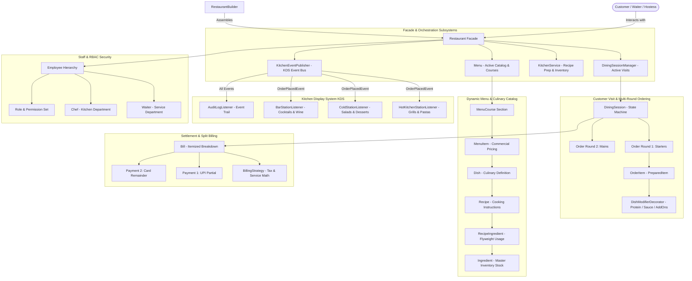
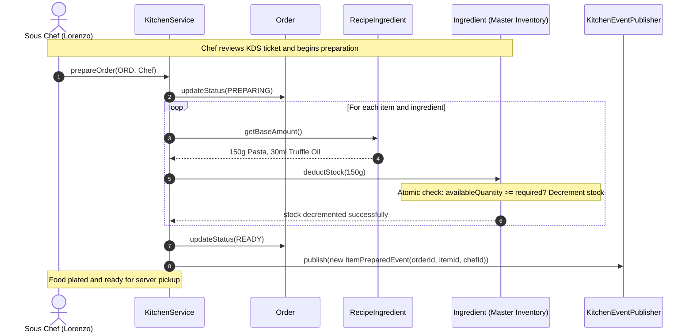

# Restaurant Management System — Low-Level Design (LLD)

[](https://openjdk.org/projects/jdk/21/)
[](pom.xml)
[](src/test/java/com/restaurant)
[](RestaurantDesign.md)

A production-grade, object-oriented Low-Level Design (LLD) and Machine Coding implementation for an enterprise **Restaurant Management System** in Java 21 adhering to clean architecture, SOLID principles, and Gang of Four (GoF) design patterns.

---

## 1. System Requirements & Feature Matrix

| # | Requirement | Implementation Details | Design Pattern / Component |
| :---: | :--- | :--- | :--- |
| **1** | **Restaurant Aggregate** | Multi-attribute entity (`name`, `address`, `cuisines`, `menu`, `waiters`, `chefs`). | `Restaurant` (**Facade Pattern**) |
| **2** | **Dynamic Cuisines** | Decoupled master cuisine entities (`Italian`, `French`, `Chinese`, `Indian`, etc.). | `Cuisine`, `CuisineType` |
| **3** | **Menu & Course Hierarchy** | Composable catalog views dividing dishes into courses (`Soups`, `Appetizers`, `Mains`). | `Menu`, `MenuCourse`, `Course` (**Bridge Pattern**) |
| **4** | **Decoupled Commercial Pricing** | `Dish` is price-agnostic culinary metadata; `MenuItem` holds commercial pricing per menu. | `Dish`, `MenuItem` |
| **5** | **Ingredient & Measurement** | Measurement dimensions (`MASS`, `VOLUME`, `COUNT`) with base conversion factors (`g`, `ml`, `tsp`, `tbsp`, `cup`). | `Unit`, `Ingredient`, `RecipeIngredient` (**Flyweight Pattern**) |
| **6** | **Staff RBAC & Hierarchy** | Decoupled permissions, roles, and departments (`KITCHEN` vs `SERVICE`) instead of hardcoded levels. | `Employee`, `Waiter`, `Chef`, `Role`, `Department`, `Permission` (RBAC) |
| **7** | **Customizable Dishes** | Dynamic protein, sauce, and add-on decoration without combinatorial variant explosion ($4 \times 4 \times 3 = 48$). | `PreparedItem`, `DishModifierDecorator`, `ProteinDecorator`, `SauceDecorator`, `AddOnDecorator` (**Decorator Pattern**) |
| **8** | **Multi-Round Visit Lifecycle** | Tracks customers across dining visits with multiple ordering rounds (`Round 1: Starters`, `Round 2: Mains`). | `DiningSession`, `Order`, `OrderItem` (**State Pattern**) |
| **9** | **Kitchen Display System (KDS)** | Decoupled event bus broadcasting orders to station displays (`HOT_KITCHEN`, `COLD_COUNTER`, `BAR_DISPENSE`). | `KitchenEventPublisher`, `HotKitchenStationListener`, `ColdStationListener`, `BarStationListener` (**Observer Pattern**) |
| **10**| **Kitchen Inventory Depletion** | Concurrency-safe atomic deduction of raw ingredient stocks upon kitchen order preparation. | `KitchenService`, `Ingredient.deductStock()` |
| **11**| **Itemized Settlement & Taxes** | Pluggable tax (GST) and service fee calculation with `BigDecimal` precision. | `BillingStrategy`, `StandardBillingStrategy`, `DiscountedBillingStrategy` (**Strategy Pattern**) |
| **12**| **Split Payment Capability** | Supports partial split payments across multiple payment methods (`CASH`, `UPI`, `CARD`). | `Bill`, `Payment`, `BillStatus` (`UNPAID` $\to$ `PARTIALLY_PAID` $\to$ `PAID`) |
| **13**| **Future Reservations** | Calendar booking entity that spawns an active `DiningSession` upon check-in. | `Reservation`, `ReservationStatus` |
| **14**| **Fluent Construction** | Step-by-step restaurant, menu, and recipe assembly. | `RestaurantBuilder`, `MenuBuilder`, `RecipeBuilder` (**Builder Pattern**) |

---

## 2. High-Level Architecture Topology



---

## 3. Comprehensive UML Class Diagram

```mermaid
classDiagram
    direction TB

    %% Enums
    class CuisineType {
        <<enumeration>>
        ITALIAN
        FRENCH
        CHINESE
        JAPANESE
        INDIAN
        CONTINENTAL
    }

    class DietaryType {
        <<enumeration>>
        VEG
        NON_VEG
        VEGAN
    }

    class Department {
        <<enumeration>>
        KITCHEN
        SERVICE
    }

    class Permission {
        <<enumeration>>
        TAKE_ORDER
        PREPARE_FOOD
        APPROVE_RECIPE
        GENERATE_BILL
        VOID_BILL
    }

    class Unit {
        <<enumeration>>
        GRAM
        KILOGRAM
        MILLILITER
        LITER
        TEASPOON
        TABLESPOON
        CUP
        PIECE
        PINCH
        +getConversionFactor() double
    }

    class KitchenStation {
        <<enumeration>>
        HOT_KITCHEN
        COLD_COUNTER
        BAR_DISPENSE
    }

    class OrderChannel {
        <<enumeration>>
        DINE_IN
        TAKEAWAY
        DELIVERY
    }

    class OrderStatus {
        <<enumeration>>
        RECEIVED
        PREPARING
        READY
        SERVED
        CANCELLED
    }

    class SessionStatus {
        <<enumeration>>
        ACTIVE
        BILLED
        SETTLED
        CANCELLED
    }

    class BillStatus {
        <<enumeration>>
        UNPAID
        PARTIALLY_PAID
        PAID
    }

    class PaymentMethod {
        <<enumeration>>
        CASH
        CREDIT_CARD
        DEBIT_CARD
        UPI
    }

    %% Value Objects
    class Address {
        <<value object>>
        -String street
        -String city
        -String state
        -String postalCode
        -String country
        +getFormattedAddress() String
    }

    class RecipeIngredient {
        <<value object>>
        -Ingredient ingredient
        -double amount
        -Unit unit
        +getBaseAmount() double
    }

    %% Staff & RBAC
    class Employee {
        <<abstract>>
        #String id
        #String name
        #String email
        #String phoneNumber
        #Department department
        #Role role
        +hasPermission(permission) boolean
    }

    class Role {
        -String id
        -String name
        -Department department
        -Set~Permission~ permissions
        +hasPermission(permission) boolean
    }

    class Waiter {
        -List~String~ assignedTables
        +assignTable(tableNumber)
        +unassignTable(tableNumber)
    }

    class Chef {
        +canPrepareFood() boolean
        +canApproveRecipe() boolean
    }

    Employee <|-- Waiter
    Employee <|-- Chef
    Employee o-- Role
    Employee --> Department
    Role o-- Permission

    %% Inventory & Recipes
    class Ingredient {
        -String id
        -String name
        -Unit baseUnit
        -double availableQuantity
        +deductStock(amount)
        +restock(amount)
        +hasEnoughStock(required) boolean
    }

    class Recipe {
        -String id
        -String title
        -List~String~ instructions
        -int prepTimeMinutes
        -int cookTimeMinutes
        -List~RecipeIngredient~ ingredients
        +getIngredients() List
    }

    RecipeIngredient o-- Ingredient
    RecipeIngredient --> Unit
    Recipe *-- "1..*" RecipeIngredient

    %% Catalog & Decoupled Menu
    class Cuisine {
        -String id
        -String name
        -CuisineType type
        -boolean active
    }

    class Course {
        -String id
        -String name
    }

    class Dish {
        -String id
        -String name
        -String description
        -DietaryType dietaryType
        -Cuisine cuisine
        -Recipe recipe
        -KitchenStation targetStation
    }

    class MenuItem {
        -String id
        -Dish dish
        -BigDecimal price
        -boolean available
        +getPrice() BigDecimal
    }

    class MenuCourse {
        -String id
        -Course course
        -boolean active
        -int displayOrder
        -List~MenuItem~ items
        +addItem(item)
    }

    class Menu {
        -String id
        -String name
        -List~MenuCourse~ menuCourses
        +findMenuItemById(id) Optional
        +filterByDietary(type) List
    }

    Dish --> DietaryType
    Dish o-- Cuisine
    Dish *-- Recipe
    Dish --> KitchenStation
    MenuItem o-- Dish
    MenuCourse o-- Course
    MenuCourse *-- "1..*" MenuItem
    Menu *-- "1..*" MenuCourse

    %% Customization & Decorator Pattern
    class PreparedItem {
        <<interface>>
        +getName() String
        +getPrice() BigDecimal
        +getDietaryType() DietaryType
        +getIngredients() List
        +getCookingInstructions() List
        +getRootDish() Dish
    }

    class BaseDishItem {
        -MenuItem menuItem
        +getPrice() BigDecimal
        +getRootDish() Dish
    }

    class DishModifierDecorator {
        <<abstract>>
        #PreparedItem wrappedItem
        +getPrice() BigDecimal
        +getRootDish() Dish
    }

    class ProteinDecorator {
        -String proteinName
        -BigDecimal additionalPrice
        -DietaryType proteinDietaryType
        -RecipeIngredient proteinIngredient
        +getPrice() BigDecimal
        +getDietaryType() DietaryType
    }

    class SauceDecorator {
        -String sauceName
        -BigDecimal additionalPrice
        -RecipeIngredient sauceIngredient
        +getPrice() BigDecimal
    }

    class AddOnDecorator {
        -String addOnName
        -BigDecimal additionalPrice
        -RecipeIngredient addOnIngredient
        +getPrice() BigDecimal
    }

    PreparedItem <|.. BaseDishItem
    PreparedItem <|.. DishModifierDecorator
    DishModifierDecorator o-- PreparedItem
    DishModifierDecorator <|-- ProteinDecorator
    DishModifierDecorator <|-- SauceDecorator
    DishModifierDecorator <|-- AddOnDecorator

    %% Ordering, Sessions & Visits
    class Customer {
        -String id
        -String name
        -String phoneNumber
        -String email
    }

    class OrderItem {
        -String id
        -PreparedItem preparedItem
        -int quantity
        -String specialInstructions
        +getSubtotal() BigDecimal
    }

    class Order {
        -String id
        -OrderChannel channel
        -LocalDateTime placedAt
        -OrderStatus status
        -List~OrderItem~ items
        +addItem(item)
        +calculateSubtotal() BigDecimal
        +updateStatus(status)
    }

    class DiningSession {
        -String sessionId
        -String tableNumber
        -Customer primaryCustomer
        -List~Customer~ partyMembers
        -Waiter assignedWaiter
        -SessionStatus status
        -List~Order~ orders
        -Bill bill
        +addOrder(order)
        +generateBill(strategy) Bill
        +applyPayment(payment)
    }

    class Reservation {
        -String id
        -Customer customer
        -String tableNumber
        -int partySize
        -LocalDateTime reservedSlot
        -ReservationStatus status
        +checkIn(sessionId, waiter) DiningSession
    }

    OrderItem o-- PreparedItem
    Order *-- "1..*" OrderItem
    Order --> OrderChannel
    Order --> OrderStatus
    Reservation o-- Customer
    DiningSession o-- Customer
    DiningSession o-- Waiter
    DiningSession *-- "1..*" Order : "Multi-round orders during visit"
    DiningSession --> SessionStatus

    %% KDS Event Bus (Observer Pattern)
    class KitchenEvent {
        <<interface>>
        +getEventId() String
        +getTimestamp() LocalDateTime
        +getEventType() String
    }

    class OrderPlacedEvent {
        -String sessionId
        -String tableNumber
        -Order order
    }

    class KitchenEventListener {
        <<interface>>
        +onEvent(event)
    }

    class KitchenEventPublisher {
        -List~KitchenEventListener~ listeners
        +registerListener(listener)
        +unregisterListener(listener)
        +publish(event)
    }

    class HotKitchenStationListener {
        -List~String~ activeHotTickets
        +onEvent(event)
    }

    class ColdStationListener {
        -List~String~ activeColdTickets
        +onEvent(event)
    }

    class BarStationListener {
        -List~String~ activeDrinkTickets
        +onEvent(event)
    }

    KitchenEvent <|.. OrderPlacedEvent
    KitchenEventPublisher o-- KitchenEventListener
    KitchenEventListener <|.. HotKitchenStationListener
    KitchenEventListener <|.. ColdStationListener
    KitchenEventListener <|.. BarStationListener

    %% Billing & Split Payments (Strategy Pattern)
    class Payment {
        -String paymentId
        -BigDecimal amount
        -PaymentMethod method
        -String transactionReference
        -LocalDateTime paidAt
    }

    class Bill {
        -String billId
        -String sessionId
        -BigDecimal itemSubtotal
        -BigDecimal taxAmount
        -BigDecimal serviceCharge
        -BigDecimal discountAmount
        -BigDecimal totalPayable
        -BillStatus billStatus
        -List~Payment~ payments
        +addPayment(payment)
        +getRemainingAmount() BigDecimal
        +isFullyPaid() boolean
    }

    class BillingStrategy {
        <<interface>>
        +computeBill(sessionId, orders) Bill
    }

    class StandardBillingStrategy {
        -BigDecimal taxRate
        -BigDecimal serviceChargeRate
        +computeBill(sessionId, orders) Bill
    }

    class DiscountedBillingStrategy {
        -BigDecimal taxRate
        -BigDecimal serviceChargeRate
        -BigDecimal discountRate
        +computeBill(sessionId, orders) Bill
    }

    DiningSession *-- "0..1" Bill
    DiningSession ..> BillingStrategy
    BillingStrategy <|.. StandardBillingStrategy
    BillingStrategy <|.. DiscountedBillingStrategy
    Bill *-- "0..*" Payment : "Split payments (Cash + UPI + Card)"
    Payment --> PaymentMethod
    Bill --> BillStatus

    %% Top-Level Restaurant Aggregate
    class Restaurant {
        -String name
        -Address address
        -Set~Cuisine~ cuisines
        -Menu menu
        -List~Waiter~ waiters
        -List~Chef~ chefs
        -DiningSessionManager sessionManager
        -KitchenService kitchenService
        -KitchenEventPublisher eventPublisher
        +startDiningSession(sessionId, tableNumber, customer, waiter) DiningSession
        +placeOrder(session, order)
        +cookOrder(order, chef)
    }

    Restaurant *-- Address
    Restaurant o-- Cuisine
    Restaurant *-- Menu
    Restaurant o-- Waiter
    Restaurant o-- Chef
    Restaurant *-- DiningSessionManager
    Restaurant *-- KitchenService
    Restaurant *-- KitchenEventPublisher
```



---

## 4. Key Dynamic Sequence Flows

### 4.1 Flow 1: Multi-Round Dining, Customization & KDS Event Bus Routing
```mermaid
sequenceDiagram
    autonumber
    actor Customer as Customer (Anirudh)
    actor Waiter as Waiter (Devashish)
    participant SM as DiningSessionManager
    participant DS as DiningSession
    participant ORD as Order (Round 1)
    participant DEC as DishModifierDecorator
    participant EP as KitchenEventPublisher
    participant HK as HotKitchenStationListener
    participant BAR as BarStationListener

    Note over Customer, Waiter: Customer arrives and is seated at Table-4
    Waiter ->> SM: openSession("SESS-01", "Table-4", Customer, Waiter)
    SM ->> DS: new DiningSession(...) [State: ACTIVE]
    SM -->> Waiter: session instance returned

    Note over Customer, Waiter: Round 1: Pasta with Chicken + Negroni Cocktail
    Customer ->> Waiter: Order Truffle Penne (add Chicken) & 1 Negroni
    Waiter ->> DEC: wrap(basePenne, chickenDecorator)
    Note over DEC: Price = ₹650 + ₹100 = ₹750; Dietary = NON_VEG
    Waiter ->> ORD: new Order(DINE_IN) -> addItem(Penne), addItem(Negroni)
    Waiter ->> DS: addOrder(ORD)
    DS ->> EP: publish(new OrderPlacedEvent("SESS-01", "Table-4", ORD))
    
    par KDS Station Dispatch
        EP ->> HK: onEvent(OrderPlacedEvent)
        Note over HK: Filter targetStation == HOT_KITCHEN -> Displays "[Table-4] 1x Truffle Penne with Chicken"
    and
        EP ->> BAR: onEvent(OrderPlacedEvent)
        Note over BAR: Filter targetStation == BAR_DISPENSE -> Displays "[Table-4] 1x Negroni"
    end
```

### 4.2 Flow 2: Concurrency-Safe Inventory Depletion & Kitchen Preparation


### 4.3 Flow 3: Itemized Bill Generation & Split Settlement
```mermaid
sequenceDiagram
    autonumber
    actor GuestA as Guest A (Anirudh)
    actor GuestB as Guest B (Vikram)
    actor Waiter as Waiter (Devashish)
    participant DS as DiningSession
    participant STRAT as StandardBillingStrategy
    participant B as Bill
    participant SM as DiningSessionManager

    Note over GuestA, Waiter: Meal concluded; guests request bill
    Waiter ->> DS: generateBill(StandardBillingStrategy)
    DS ->> STRAT: computeBill(sessionId, orders)
    STRAT -->> DS: new Bill(subtotal: ₹2000, tax: ₹100, service: ₹200 -> Total: ₹2300)
    Note over DS: Session transitions to BILLED. No more orders allowed!

    Note over GuestA, B: Split Payment: Guest A pays ₹1000 via UPI
    GuestA ->> Waiter: Pay ₹1000 via UPI
    Waiter ->> DS: applyPayment(new Payment(₹1000, UPI))
    DS ->> B: addPayment(Payment)
    Note over B: Bill status = PARTIALLY_PAID, Remaining = ₹1300

    Note over GuestB, B: Guest B pays remaining ₹1300 via Credit Card
    GuestB ->> Waiter: Pay ₹1300 via Card
    Waiter ->> DS: applyPayment(new Payment(₹1300, CREDIT_CARD))
    DS ->> B: addPayment(Payment)
    Note over B: Remaining = ₹0.00 -> Bill status = PAID
    Note over DS: Session status = SETTLED, closedAt = now()

    Waiter ->> SM: closeSession(sessionId)
    SM ->> SM: remove table mapping, unassign table from waiter
    Note over SM: Table-4 is now clean and AVAILABLE for next guests
```

---

## 5. Design Patterns Deep Dive & Concrete Justification

| Pattern | Category | Where Applied | Concrete Architectural Justification |
| :--- | :--- | :--- | :--- |
| **Facade** | Structural | `Restaurant` | Unified entry point hiding `DiningSessionManager`, `KitchenService`, and `Menu` complexity from UI or clients. |
| **Decorator** | Structural | `DishModifierDecorator`<br>`ProteinDecorator`<br>`SauceDecorator`<br>`AddOnDecorator` | Dynamically decorates protein, sauce, and extra toppings at runtime while adjusting dietary type, eliminating Cartesian product explosion ($4 \times 4 \times 3 = 48$). |
| **Flyweight** | Structural | `RecipeIngredient` $\to$ `Ingredient` | Centralizes kitchen inventory stock in master `Ingredient` while recipes reference lightweight contextual quantities with base-unit conversions. |
| **State** | Behavioral | `DiningSession` (`ACTIVE` $\to$ `BILLED` $\to$ `SETTLED`) | Governs the visit lifecycle. Strictly guards invariants: prevents new orders once a bill is generated. |
| **Strategy** | Behavioral | `BillingStrategy`<br>`StandardBillingStrategy`<br>`DiscountedBillingStrategy` | Pluggable tax (GST/VAT), service fees, and festival discounts using `BigDecimal` for zero floating-point drift. |
| **Observer** | Behavioral | `KitchenEventPublisher`<br>`HotKitchenStationListener`<br>`ColdStationListener`<br>`BarStationListener` | Event-driven KDS station routing: automatically routes dishes to the correct preparation screens upon order placement. |
| **Builder** | Creational | `RestaurantBuilder`<br>`MenuBuilder`<br>`RecipeBuilder` | Declarative, fluent construction of complex domain hierarchies. |

---

## 6. In-Depth Socratic Analysis & Engineering Trade-offs

### Dilemma 1: Why `Dish` Should Not Have a Price Field
- **The Junior Approach**: Adding `BigDecimal price` directly to `Dish`.
- **Why this fails in Enterprise Systems**:
  - The same dish is sold at different prices across different channels (e.g. In-house dining vs Swiggy/Zomato delivery vs Airport branch vs Happy Hour discount menu).
  - Tying price to `Dish` violates the Single Responsibility Principle by mixing culinary specifications (recipes, calories, dietary tags) with commercial catalog marketing.
- **The Staff Resolution**:
  - `Dish`: Pure culinary master record (`name`, `description`, `recipe`, `dietaryType`).
  - `MenuItem`: The commercial catalog entry binding `Dish` to a specific `Menu` with `price` and `isAvailable`.

---

### Dilemma 2: Combinatorial Variant Explosion vs Decorator Pattern
- **The Junior Approach**: Creating distinct subclasses or database rows for every permutation (`ChickenArrabiataPenne`, `VegArrabiataPenne`, `ChickenAlfredoPenne`, `VegAlfredoPenne`, etc.).
  - With 4 proteins, 4 sauces, and 3 pasta shapes, this requires **48 separate variant entities**.
- **The Staff Resolution**:
  - Employ the **GoF Decorator Pattern**.
  - `BaseDishItem` wraps the base pasta.
  - `ProteinDecorator` decorates the base item, adds the protein price, and dynamically adjusts the dietary type to `NON_VEG`.
  - `SauceDecorator` adds the sauce price and simmering instructions.
  - Total entities: **$4 + 4 + 3 = 11$ options**, zero Cartesian product explosion.

---

### Dilemma 3: Multi-Round Ordering & Temporal Session Modeling
- **The Junior Trap**: Binding an `Order` 1:1 to a `Customer` or `Table`.
- **The Reality of Dining**:
  - Customers sit at a table for 1 to 2 hours.
  - They place orders in distinct rounds:
    - Round 1 (12:05 PM): Appetizers & Drinks.
    - Round 2 (12:35 PM): Mains.
    - Round 3 (01:15 PM): Desserts & Coffee.
  - Each round is an independent `Order` routed to the kitchen, but all rounds belong to a single **`DiningSession`**.
- **State Machine Invariant**:
  - Once the customer requests the bill (`generateBill()`), the session transitions to `BILLED`.
  - Calling `addOrder()` in `BILLED` or `SETTLED` state throws `IllegalStateException`.

---

### Dilemma 4: Split Payments
- A bill is rarely settled via a single payment in group dining.
- Modeling `Bill (1) *-- (0..*) Payment` enables:
  - Partial payments via different methods (e.g. ₹1,000 via UPI + ₹610 via Credit Card).
  - Transitioning from `UNPAID` $\to$ `PARTIALLY_PAID` $\to$ `PAID`.
  - Strict guard against overpayments (`payment.amount > bill.getRemainingAmount()`).

---

## 7. Verification & Comprehensive Test Suite

The project includes **51 JUnit 5 tests** passing with a 100% success rate:

```bash
mvn clean test
```

```
[INFO] -------------------------------------------------------
[INFO]  T E S T S
[INFO] -------------------------------------------------------
[INFO] Running com.restaurant.MenuCourseAndItemManagementTest      (4 tests  - PASSED)
[INFO] Running com.restaurant.ConcurrentOrderingStressTest         (3 tests  - PASSED)
[INFO] Running com.restaurant.MultiRoundDiningAndSplitBillingTest  (3 tests  - PASSED)
[INFO] Running com.restaurant.RestaurantBuilderTest                (4 tests  - PASSED)
[INFO] Running com.restaurant.RestaurantIntegrationTest            (1 test   - PASSED)
[INFO] Running com.restaurant.DiningSessionManagerContentionTest   (2 tests  - PASSED)
[INFO] Running com.restaurant.ReservationLifecycleTest            (2 tests  - PASSED)
[INFO] Running com.restaurant.MeasurementAndInventoryTest          (4 tests  - PASSED)
[INFO] Running com.restaurant.EmployeeAndPermissionTest            (3 tests  - PASSED)
[INFO] Running com.restaurant.DiscountAndTaxStrategyTest           (3 tests  - PASSED)
[INFO] Running com.restaurant.AddressAndValueObjectTest            (3 tests  - PASSED)
[INFO] Running com.restaurant.DecoratorPatternTest                 (3 tests  - PASSED)
[INFO] Running com.restaurant.MenuAndCatalogTest                   (2 tests  - PASSED)
[INFO] Running com.restaurant.OrderCancellationAndWasteTest        (3 tests  - PASSED)
[INFO] Running com.restaurant.KitchenEventBusTest                  (6 tests  - PASSED)
[INFO] Running com.restaurant.ConcurrentInventoryStressTest        (2 tests  - PASSED)
[INFO] Running com.restaurant.StaffAndRBACTest                      (3 tests  - PASSED)
[INFO] 
[INFO] Results:
[INFO] Tests run: 51, Failures: 0, Errors: 0, Skipped: 0
[INFO] BUILD SUCCESS
```

---

## 8. Concurrency Invariants & Mathematical Proofs

### 8.1 Zero Floating-Point Precision
All monetary operations (`Dish.price`, `Bill.itemSubtotal`, `taxAmount`, `serviceCharge`, `totalPayable`, `Payment.amount`) strictly utilize `java.math.BigDecimal` configured with `scale = 2` and `RoundingMode.HALF_UP`.
$$\text{Total Payable} = \text{round}_{2}\left(\text{Subtotal} \cdot (1 - \text{Discount}) \cdot (1 + \text{Tax Rate} + \text{Service Rate})\right)$$
Floating-point binary representations (`float`, `double`) are banned to eliminate cumulative cent rounding drift.

### 8.2 Atomic Inventory Depletion
In a high-throughput kitchen, multiple chefs concurrently prepare orders using the same scarce raw ingredient (e.g. fresh burrata or truffle oil). 
The `Ingredient.deductStock()` method is guarded by synchronized atomic boundaries:
$$\forall t: \quad \text{availableQuantity}_t \ge 0$$
If $M$ concurrent threads attempt to deduct $\Delta$ when current stock is $S$, exactly $\lfloor S / \Delta \rfloor$ operations succeed, and all remaining attempts fail gracefully with `IllegalStateException`, preserving non-negative stock invariants. Verified via `ConcurrentInventoryStressTest`.

### 8.3 Post-Billing Immutability
Once `DiningSession.generateBill()` is called:
$$\text{SessionState} \leftarrow \text{BILLED}$$
Any subsequent call to `session.addOrder(...)` throws `IllegalStateException`. This prevents the "sneaked dessert" race condition where items are cooked after the invoice has been presented to the customer. Verified via `ConcurrentOrderingStressTest`.
