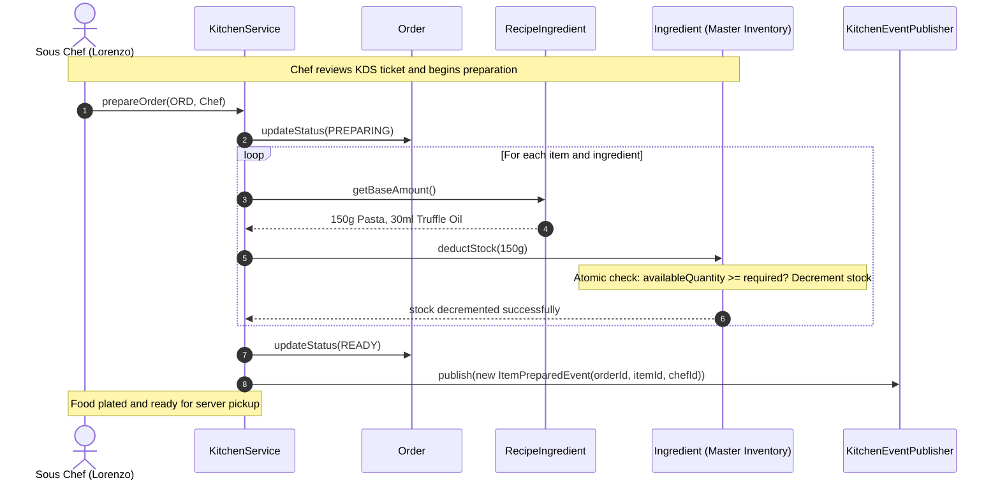

# Comprehensive Architectural Design & Decision Log
## Enterprise Restaurant Management System Low-Level Design (LLD)

---

## 1. Executive Sequence Diagrams

### 1.1 Multi-Round Dining, Customization & KDS Event Bus Sequence
```mermaid
sequenceDiagram
    autonumber
    actor Customer as Customer (Anirudh)
    actor Waiter as Waiter (Devashish)
    participant SM as DiningSessionManager
    participant DS as DiningSession
    participant ORD as Order (Round 1)
    participant DEC as DishModifierDecorator
    participant EP as KitchenEventPublisher
    participant HK as HotKitchenStationListener
    participant BAR as BarStationListener

    Note over Customer, Waiter: Customer arrives and is seated at Table-4
    Waiter ->> SM: openSession("SESS-01", "Table-4", Customer, Waiter)
    SM ->> DS: new DiningSession(...) [State: ACTIVE]
    SM -->> Waiter: session instance returned

    Note over Customer, Waiter: Round 1: Pasta with Chicken + Negroni Cocktail
    Customer ->> Waiter: Order Truffle Penne (add Chicken) & 1 Negroni
    Waiter ->> DEC: wrap(basePenne, chickenDecorator)
    Note over DEC: Price = ₹650 + ₹100 = ₹750; Dietary = NON_VEG
    Waiter ->> ORD: new Order(DINE_IN) -> addItem(Penne), addItem(Negroni)
    Waiter ->> DS: addOrder(ORD)
    DS ->> EP: publish(new OrderPlacedEvent("SESS-01", "Table-4", ORD))
    
    par KDS Station Dispatch
        EP ->> HK: onEvent(OrderPlacedEvent)
        Note over HK: Filter targetStation == HOT_KITCHEN -> Displays "[Table-4] 1x Truffle Penne with Chicken"
    and
        EP ->> BAR: onEvent(OrderPlacedEvent)
        Note over BAR: Filter targetStation == BAR_DISPENSE -> Displays "[Table-4] 1x Negroni"
    end
```

---

### 1.2 High-Contention Inventory Depletion & Kitchen Cooking Sequence


---

### 1.3 Split Payment Settlement & Session Closure Sequence
```mermaid
sequenceDiagram
    autonumber
    actor GuestA as Guest A (Anirudh)
    actor GuestB as Guest B (Vikram)
    actor Waiter as Waiter (Devashish)
    participant DS as DiningSession
    participant STRAT as StandardBillingStrategy
    participant B as Bill
    participant SM as DiningSessionManager

    Note over GuestA, Waiter: Meal concluded; guests request bill
    Waiter ->> DS: generateBill(StandardBillingStrategy)
    DS ->> STRAT: computeBill(sessionId, orders)
    STRAT -->> DS: new Bill(subtotal: ₹2000, tax: ₹100, service: ₹200 -> Total: ₹2300)
    Note over DS: Session transitions to BILLED. No more orders allowed!

    Note over GuestA, B: Split Payment: Guest A pays ₹1000 via UPI
    GuestA ->> Waiter: Pay ₹1000 via UPI
    Waiter ->> DS: applyPayment(new Payment(₹1000, UPI))
    DS ->> B: addPayment(Payment)
    Note over B: Bill status = PARTIALLY_PAID, Remaining = ₹1300

    Note over GuestB, B: Guest B pays remaining ₹1300 via Credit Card
    GuestB ->> Waiter: Pay ₹1300 via Card
    Waiter ->> DS: applyPayment(new Payment(₹1300, CREDIT_CARD))
    DS ->> B: addPayment(Payment)
    Note over B: Remaining = ₹0.00 -> Bill status = PAID
    Note over DS: Session status = SETTLED, closedAt = now()

    Waiter ->> SM: closeSession(sessionId)
    SM ->> SM: remove table mapping, unassign table from waiter
    Note over SM: Table-4 is now clean and AVAILABLE for next guests
```

---

## 2. System Requirements & Domain Scope

### 2.1 Problem Statement
Design an extensible, concurrency-safe, multi-station **Restaurant Management System** capable of managing dynamic menus with decoupled commercial pricing, fine-grained inventory depletion with dimensional conversion factors, staff role-based access control (RBAC), multi-round customer dining sessions, kitchen display system (KDS) event routing, and split-payment billing with zero floating-point drift.

### 2.2 Core Capabilities
1. **Dynamic Cuisines**: Pluggable cuisine entities (`Cuisine`) allowing restaurant admins to activate/deactivate cuisines without code redeployment.
2. **Decoupled Commercial Catalog**: `Dish` represents pure culinary metadata (recipe, dietary tags, cooking instructions); `MenuItem` binds the dish to a specific `Menu` with commercial pricing.
3. **Flyweight Ingredient Measurement**: Solid (`GRAM`, `KILOGRAM`) and liquid (`MILLILITER`, `LITER`, `TEASPOON`, `TABLESPOON`, `CUP`) measurements are unified under `Unit` with base conversion factors. Master inventory (`Ingredient`) tracks central kitchen stock; recipes hold lightweight contextual usages (`RecipeIngredient`).
4. **Decorator Pattern for Customizations**: Prevents combinatorial variant explosion ($4 \text{ proteins} \times 4 \text{ sauces} = 16 \text{ variants}$) by dynamically decorating base dishes with proteins, sauces, and extra add-ons at runtime while updating dietary types.
5. **Staff RBAC & Hierarchy**: Replaces fragile enum levels (`Junior`, `Senior`) with production-grade Role-Based Access Control (`Role`, `Department`, `Permission`).
6. **Multi-Round Dining Session State Machine**: Models physical customer visits across ordering rounds (`Round 1: Appetizers`, `Round 2: Mains`). Session transitions strictly from `ACTIVE` $\to$ `BILLED` $\to$ `SETTLED`.
7. **Kitchen Display System (KDS) Event Bus**: Decoupled Observer bus broadcasting `OrderPlacedEvent`, `ItemPreparedEvent`, and `OrderCancelledEvent` to specialized station screens (`HotKitchenStationListener`, `ColdStationListener`, `BarStationListener`).
8. **Itemized Settlement & Split Billing**: Aggregates all non-cancelled orders across visit rounds into an immutable `Bill`, supporting partial payments across multiple payment methods (`CASH`, `UPI`, `CARD`).
9. **Concurrency Invariants**: Multi-threaded table sessions, synchronized atomic inventory deductions, and thread contention guards tested using `CountDownLatch`.

---

## 3. Design Patterns Applied & Rationale

| Pattern | Category | Where Applied | Concrete Architectural Justification |
| :--- | :--- | :--- | :--- |
| **Facade** | Structural | `Restaurant` | Hides subsystem complexity (`DiningSessionManager`, `KitchenService`, `Menu`, `KitchenEventPublisher`) behind clean client entry points. |
| **Decorator** | Structural | `DishModifierDecorator`<br>`ProteinDecorator`<br>`SauceDecorator`<br>`AddOnDecorator` | Dynamically composes custom dishes at runtime, aggregating prices, ingredients, and instructions without creating dozens of rigid variant classes. |
| **Flyweight** | Structural | `RecipeIngredient` $\to$ `Ingredient` | Separates shared intrinsic master inventory from lightweight extrinsic recipe usages. |
| **State** | Behavioral | `DiningSession` (`ACTIVE` $\to$ `BILLED` $\to$ `SETTLED`) | Enforces lifecycle invariants: prevents new orders from being placed once a bill is generated. |
| **Strategy** | Behavioral | `BillingStrategy`<br>`StandardBillingStrategy`<br>`DiscountedBillingStrategy` | Swaps mathematical fee and tax algorithms (Standard GST vs Festival Discounts) with exact `BigDecimal` scale. |
| **Observer** | Behavioral | `KitchenEventPublisher`<br>`HotKitchenStationListener`<br>`ColdStationListener`<br>`BarStationListener` | Decouples order placement from kitchen station displays, allowing stations to filter tickets independently. |
| **Builder** | Creational | `RestaurantBuilder`<br>`MenuBuilder`<br>`RecipeBuilder` | Provides fluent, declarative construction of complex aggregate roots and nested catalog hierarchies. |

---

## 4. Concurrency Invariants & Mathematical Proofs

### 4.1 Zero Floating-Point Precision
All monetary operations (`Dish.price`, `Bill.itemSubtotal`, `taxAmount`, `serviceCharge`, `totalPayable`, `Payment.amount`) strictly utilize `java.math.BigDecimal` configured with `scale = 2` and `RoundingMode.HALF_UP`.
$$\text{Total Payable} = \text{round}_{2}\left(\text{Subtotal} \cdot (1 - \text{Discount}) \cdot (1 + \text{Tax Rate} + \text{Service Rate})\right)$$
Floating-point binary representations (`float`, `double`) are banned to eliminate cumulative cent rounding drift.

### 4.2 Atomic Inventory Depletion
In a high-throughput kitchen, multiple chefs concurrently prepare orders using the same scarce raw ingredient (e.g. fresh burrata or truffle oil). 
The `Ingredient.deductStock()` method is guarded by synchronized atomic boundaries:
$$\forall t: \quad \text{availableQuantity}_t \ge 0$$
If $M$ concurrent threads attempt to deduct $\Delta$ when current stock is $S$, exactly $\lfloor S / \Delta \rfloor$ operations succeed, and all remaining attempts fail gracefully with `IllegalStateException`, preserving non-negative stock invariants. Verified via `ConcurrentInventoryStressTest`.

### 4.3 Post-Billing Immutability
Once `DiningSession.generateBill()` is called:
$$\text{SessionState} \leftarrow \text{BILLED}$$
Any subsequent call to `session.addOrder(...)` throws `IllegalStateException`. This prevents the "sneaked dessert" race condition where items are cooked after the invoice has been presented to the customer. Verified via `ConcurrentOrderingStressTest`.

