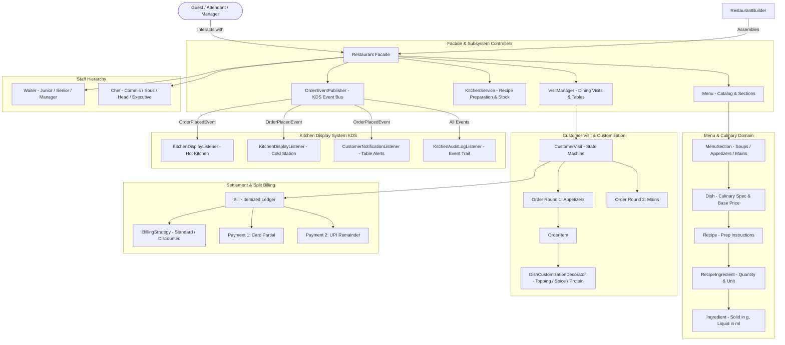

# Comprehensive Architectural Design & Decision Log
## Enterprise Restaurant Management System Low-Level Design (LLD)

---

## 1. Executive Sequence Diagrams

### 1.1 Multi-Round Dining, Customization & KDS Event Bus Sequence
```mermaid
sequenceDiagram
    autonumber
    actor Customer as Customer (Anirudh)
    actor Waiter as Waiter (John Doe - Senior)
    participant R as Restaurant Facade
    participant VM as VisitManager
    participant CV as CustomerVisit
    participant DEC as DishCustomizationDecorator
    participant ORD as Order (Round 1)
    participant EP as OrderEventPublisher
    participant HK as KitchenDisplayListener (Hot Kitchen)
    participant NOTIF as CustomerNotificationListener

    Note over Customer, Waiter: Customer arrives and is seated at Table-4
    Customer ->> Waiter: Request table for dining
    Waiter ->> R: hostGuest(Customer, Table-4, Waiter)
    R ->> VM: startVisit(Customer, Table-4, Waiter)
    VM ->> Table-4: markOccupied()
    VM ->> Waiter: assignTable(Table-4)
    VM ->> CV: new CustomerVisit(...) [State: ACTIVE]
    VM -->> R: visit instance returned

    Note over Customer, Waiter: Round 1: Tagliatelle Pasta (add Truffles + Mild Spice)
    Customer ->> Waiter: Order Truffle Tagliatelle with Extra Truffles (Mild)
    Waiter ->> DEC: wrap(baseTagliatelle, ExtraToppingDecorator, SpiceLevelDecorator)
    Note over DEC: Price = ₹650 + ₹150 = ₹800; Customization Applied
    Waiter ->> ORD: new Order("ORD-001") -> addItem(customizedPasta, 2)
    Waiter ->> R: placeOrder(visitId, ORD)
    R ->> VM: placeOrder(visitId, ORD)
    VM ->> CV: placeOrder(ORD) [Validates status == ACTIVE]
    VM ->> EP: publishOrderPlaced(new OrderPlacedEvent(visit, ORD))
    
    par Asynchronous Observer Notifications
        EP ->> HK: onOrderPlaced(event)
        Note over HK: Displays ticket: "[Table-4] 2x Truffle Tagliatelle + Truffle Shavings (Mild)"
    and
        EP ->> NOTIF: onOrderPlaced(event)
        Note over NOTIF: Dispatches SMS / Table Alert to Customer
    end
```

---

### 1.2 Kitchen Preparation & Raw Stock Depletion Sequence
```mermaid
sequenceDiagram
    autonumber
    actor Chef as Chef (Pierre Gagnaire - Executive)
    participant KS as KitchenService
    participant ORD as Order ("ORD-001")
    participant D as Dish
    participant REC as Recipe
    participant RI as RecipeIngredient
    participant ING as Ingredient (Master Stock)
    participant EP as OrderEventPublisher
    participant AUDIT as KitchenAuditLogListener

    Note over Chef, KS: Chef claims order ticket and begins preparation
    Chef ->> KS: startPreparingOrder(ORD, Chef)
    loop For each OrderItem in Order
        KS ->> D: extractBaseDish(item)
        D ->> REC: getRecipe()
        loop For each RecipeIngredient in Recipe
            REC ->> RI: getIngredient(), getAmount()
            RI ->> ING: deductStock(amount * quantity)
            Note over ING: Atomic synchronized stock deduction (solids: g, liquids: ml)
        end
    end
    KS ->> ORD: updateStatus(PREPARING)
    KS ->> EP: publishStatusChanged(OrderStatusChangedEvent: PLACED -> PREPARING)
    EP ->> AUDIT: onOrderStatusChanged(event)

    Note over Chef, KS: Cooking completed; dish ready for delivery
    Chef ->> KS: markOrderReady(ORD)
    KS ->> ORD: updateStatus(READY)
    KS ->> EP: publishStatusChanged(OrderStatusChangedEvent: PREPARING -> READY)

    Note over Chef, KS: Waiter delivers dishes to table
    KS ->> ORD: updateStatus(SERVED)
    KS ->> EP: publishStatusChanged(OrderStatusChangedEvent: READY -> SERVED)
```

---

### 1.3 Split Payment & Terminal Settlement Sequence
```mermaid
sequenceDiagram
    autonumber
    actor Customer as Customer (Alice & Bob)
    actor Waiter as Waiter (John Doe)
    participant R as Restaurant Facade
    participant VM as VisitManager
    participant CV as CustomerVisit
    participant STRAT as StandardBillingStrategy
    participant B as Bill
    participant P1 as Payment 1 (UPI)
    participant P2 as Payment 2 (Credit Card)

    Note over Customer, Waiter: Dining complete; guests request bill
    Customer ->> Waiter: Request final check
    Waiter ->> R: generateBill(visitId, strategy)
    R ->> VM: generateBill(visitId, strategy)
    VM ->> CV: generateBill(StandardBillingStrategy)
    CV ->> STRAT: calculateBill(billId, orders)
    STRAT -->> B: new Bill(subtotal: 1600, tax: 80, service: 160, total: 1840)
    Note over CV: Visit state transitions from ACTIVE -> BILLED

    Note over Customer, Waiter: Split Payment: Alice pays ₹1000 via Card, Bob pays ₹840 via UPI
    Customer ->> Waiter: Present Credit Card for ₹1000
    Waiter ->> R: makePayment(visitId, new Payment("P1", 1000, CARD))
    R ->> VM: settlePayment(visitId, P1)
    VM ->> CV: makePayment(P1)
    CV ->> B: addPayment(P1)
    Note over B: Remaining: ₹840; Status: PARTIALLY_PAID

    Customer ->> Waiter: Scan UPI QR for remaining ₹840
    Waiter ->> R: makePayment(visitId, new Payment("P2", 840, UPI))
    R ->> VM: settlePayment(visitId, P2)
    VM ->> CV: makePayment(P2)
    CV ->> B: addPayment(P2)
    Note over B: Remaining: ₹0; Status: PAID (isFullyPaid == true)

    Note over Waiter, VM: Session Settlement & Resource Reclamation
    Waiter ->> VM: endVisit(visitId)
    VM ->> CV: completeVisit()
    CV ->> Table-4: markAvailable()
    CV ->> Waiter: releaseTable(Table-4)
    Note over VM: Table-4 freed for next party; Waiter capacity reclaimed
```

---

## 2. System Requirements & Domain Scope

### 2.1 Problem Statement
Design an enterprise-grade Restaurant Management System capable of handling high-concurrency table seatings, multi-round guest dining orders, dynamic dish customizations, real-time Kitchen Display System (KDS) event routing, physical ingredient stock depletion (enforcing solids in grams and liquids in milliliters), staff hierarchical responsibility tracking (`WaiterLevel`, `ChefLevel`), and flexible itemized billing with split-payment settlement.

### 2.2 Core Capabilities
1. **Restaurant Aggregate (Facade Pattern)**: Unified entry point encapsulating catalog, physical tables, employees, active visits, and kitchen subsystems.
2. **Explicit Staff Levels**:
   - `Waiter`: Managed via `WaiterLevel` (`JUNIOR`, `SENIOR`, `MANAGER`) with live assigned table collections.
   - `Chef`: Managed via `ChefLevel` (`COMMIS_CHEF`, `SOUS_CHEF`, `HEAD_CHEF`, `EXECUTIVE_CHEF`) mapped to specialized kitchen stations.
3. **Menu & Section Hierarchy**: Menus divided into logical courses/sections (`Soups`, `Appetizers`, `Pastas & Mains`, `Desserts`) holding master `Dish` entries.
4. **Dish Definition**: Master culinary specification with `name`, `description`, `type` (`VEG`, `NON_VEG`, `VEGAN`), `price`, `targetStation`, and `recipe`.
5. **Rigorous Physical Units**:
   - Solids strictly measured in **`MeasurementUnit.GRAMS`**.
   - Liquids / semi-liquids strictly measured in **`MeasurementUnit.MILLILITERS`**.
   - Type-enforced via `IngredientType.SOLID` vs `IngredientType.LIQUID`.
6. **Dynamic Dish Customization (Decorator Pattern)**: Composable runtime modification (`BaseDishItem`, `ExtraToppingDecorator`, `SpiceLevelDecorator`, `ProteinDecorator`) avoiding Cartesian subclass explosion ($4 \times 4 \times 3 = 48$ variants).
7. **Customer Visit Lifecycle (State Pattern)**: Tracks multi-round dining sessions:
   $$\text{ACTIVE} \xrightarrow{\text{generateBill()}} \text{BILLED} \xrightarrow{\text{all payments settled}} \text{COMPLETED}$$
8. **Kitchen Display System (Observer Pattern)**: Event-driven pub-sub routing tickets to station display screens (`KitchenDisplayListener`), customer notification bridges (`CustomerNotificationListener`), and audit logs (`KitchenAuditLogListener`).
9. **Pluggable Financial Calculation (Strategy Pattern)**: Configurable tax and service charge calculations (`StandardBillingStrategy`) and promotional discount deductions (`DiscountedBillingStrategy`).
10. **Split-Payment Ledger**: Itemized invoice (`Bill`) supporting partial settlements across heterogeneous payment instruments (`CASH`, `UPI`, `CREDIT_CARD`, `DEBIT_CARD`).
11. **Fluent Aggregate Builders (Builder Pattern)**: `RestaurantBuilder`, `MenuBuilder`, and `RecipeBuilder` ensuring valid aggregate assembly with fail-fast invariants.

---

## 3. Design Patterns Applied & Rationale

| Pattern | Category | Where Applied | Concrete Architectural Justification |
| :--- | :--- | :--- | :--- |
| **Facade** | Structural | `Restaurant` | Hides complex subsystem orchestration (`VisitManager`, `KitchenService`, `Menu`, `OrderEventPublisher`) behind high-level operations. |
| **Strategy** | Behavioral | `BillingStrategy`<br>`StandardBillingStrategy`<br>`DiscountedBillingStrategy` | Decouples financial mathematics (tax rates, service fees, loyalty discounts) from visit lifecycle, allowing instant pricing policy swaps. |
| **Observer** | Behavioral | `OrderEventPublisher`<br>`OrderEventListener`<br>`KitchenDisplayListener` | Decouples core order placement from peripheral station displays, guest SMS alerts, and compliance audit loggers. |
| **Decorator** | Structural | `OrderableItem`<br>`BaseDishItem`<br>`DishCustomizationDecorator` | Dynamically stacks toppings, spice modifications, and protein upgrades onto dishes at runtime while recalculating pricing and dietary tags. |
| **State** | Behavioral | `CustomerVisit`<br>`VisitStatus` | Enforces dining lifecycle invariants (cannot add orders once billed; cannot close visit with outstanding balance; frees table on completion). |
| **Builder** | Creational | `RestaurantBuilder`<br>`MenuBuilder`<br>`RecipeBuilder` | Assembles complex nested aggregates cleanly with invariant validation, eliminating telescoping constructor antipatterns. |

---

## 4. Architectural System Topology



---

## 5. Master UML Class Diagram

```mermaid
classDiagram
    direction TB

    %% Enums
    class CuisineType {
        <<enumeration>>
        ITALIAN
        FRENCH
        CHINESE
        JAPANESE
        INDIAN
        CONTINENTAL
        MEXICAN
    }

    class DietaryType {
        <<enumeration>>
        VEG
        NON_VEG
        VEGAN
    }

    class IngredientType {
        <<enumeration>>
        SOLID
        LIQUID
    }

    class MeasurementUnit {
        <<enumeration>>
        GRAMS
        MILLILITERS
    }

    class WaiterLevel {
        <<enumeration>>
        JUNIOR
        SENIOR
        MANAGER
    }

    class ChefLevel {
        <<enumeration>>
        COMMIS_CHEF
        SOUS_CHEF
        HEAD_CHEF
        EXECUTIVE_CHEF
    }

    class KitchenStation {
        <<enumeration>>
        HOT_KITCHEN
        COLD_STATION
        BAR
        DESSERT_STATION
    }

    class OrderStatus {
        <<enumeration>>
        PLACED
        PREPARING
        READY
        SERVED
        CANCELLED
    }

    class VisitStatus {
        <<enumeration>>
        ACTIVE
        BILLED
        COMPLETED
        CANCELLED
    }

    class BillStatus {
        <<enumeration>>
        UNPAID
        PARTIALLY_PAID
        PAID
        REFUNDED
    }

    class PaymentMethod {
        <<enumeration>>
        CASH
        CREDIT_CARD
        DEBIT_CARD
        UPI
    }

    %% Models
    class Address {
        -String street
        -String city
        -String state
        -String postalCode
        +getFormattedAddress() String
    }

    class Customer {
        -String id
        -String name
        -String phoneNumber
        -String email
    }

    class Table {
        -String tableNumber
        -int capacity
        -boolean isOccupied
        +markOccupied() void
        +markAvailable() void
    }

    class Ingredient {
        -String id
        -String name
        -IngredientType type
        -MeasurementUnit unit
        -double currentStock
        +addStock(double amount) void
        +deductStock(double amount) void
    }

    class RecipeIngredient {
        -Ingredient ingredient
        -double amount
        -MeasurementUnit unit
    }

    class Recipe {
        -String id
        -List~String~ instructions
        -int prepTimeMinutes
        -List~RecipeIngredient~ ingredients
    }

    class Dish {
        -String id
        -String name
        -String description
        -DietaryType type
        -double price
        -Recipe recipe
        -KitchenStation targetStation
        -boolean isAvailable
    }

    class MenuSection {
        -String sectionName
        -List~Dish~ dishes
        +addDish(Dish dish) void
        +findDishByName(String name) Optional~Dish~
    }

    class Menu {
        -String menuId
        -String name
        -List~MenuSection~ sections
        +addSection(MenuSection section) void
        +findDishByName(String name) Optional~Dish~
    }

    %% Staff
    class Employee {
        <<abstract>>
        #String id
        #String name
        #String email
        #String phoneNumber
    }

    class Waiter {
        -WaiterLevel level
        -List~Table~ assignedTables
        +assignTable(Table table) void
        +releaseTable(Table table) void
    }

    class Chef {
        -ChefLevel level
        -KitchenStation primaryStation
    }

    Employee <|-- Waiter
    Employee <|-- Chef
    Waiter --> WaiterLevel
    Chef --> ChefLevel
    Chef --> KitchenStation

    %% Customization Decorator
    class OrderableItem {
        <<interface>>
        +getName() String
        +getPrice() double
        +getDietaryType() DietaryType
    }

    class BaseDishItem {
        -Dish dish
        +getName() String
        +getPrice() double
        +getDietaryType() DietaryType
    }

    class DishCustomizationDecorator {
        <<abstract>>
        #OrderableItem wrappedItem
        +getName() String
        +getPrice() double
        +getDietaryType() DietaryType
    }

    class ExtraToppingDecorator {
        -String toppingName
        -double additionalCost
    }

    class SpiceLevelDecorator {
        -String spiceLevel
    }

    class ProteinDecorator {
        -String proteinName
        -double additionalCost
    }

    OrderableItem <|.. BaseDishItem
    OrderableItem <|.. DishCustomizationDecorator
    DishCustomizationDecorator <|-- ExtraToppingDecorator
    DishCustomizationDecorator <|-- SpiceLevelDecorator
    DishCustomizationDecorator <|-- ProteinDecorator
    DishCustomizationDecorator o-- OrderableItem

    %% Ordering & Visit
    class OrderItem {
        -String itemId
        -OrderableItem item
        -int quantity
        -String specialInstructions
        +getSubtotal() double
    }

    class Order {
        -String orderId
        -List~OrderItem~ items
        -OrderStatus status
        -long placedTimestamp
        +addItem(OrderItem item) void
        +updateStatus(OrderStatus status) void
        +calculateSubtotal() double
    }

    class CustomerVisit {
        -String visitId
        -Table table
        -Customer customer
        -Waiter waiter
        -List~Order~ orders
        -Bill bill
        -VisitStatus status
        +placeOrder(Order order) void
        +generateBill(BillingStrategy strategy) Bill
        +makePayment(Payment payment) void
        +completeVisit() void
    }

    OrderItem o-- OrderableItem
    Order *-- "1..*" OrderItem
    CustomerVisit o-- Table
    CustomerVisit o-- Customer
    CustomerVisit o-- Waiter
    CustomerVisit *-- "1..*" Order

    %% Billing & Split Payment
    class Payment {
        -String paymentId
        -double amount
        -PaymentMethod method
        -String transactionReference
        -long timestamp
    }

    class Bill {
        -String billId
        -double itemSubtotal
        -double taxAmount
        -double serviceCharge
        -double discountAmount
        -double totalPayable
        -BillStatus status
        -List~Payment~ payments
        +addPayment(Payment payment) void
        +getRemainingAmount() double
        +isFullyPaid() boolean
    }

    class BillingStrategy {
        <<interface>>
        +calculateBill(String billId, List~Order~ orders) Bill
    }

    class StandardBillingStrategy {
        -double taxRate
        -double serviceChargeRate
    }

    class DiscountedBillingStrategy {
        -double taxRate
        -double serviceChargeRate
        -double discountPercent
    }

    BillingStrategy <|.. StandardBillingStrategy
    BillingStrategy <|.. DiscountedBillingStrategy
    CustomerVisit *-- "0..1" Bill
    CustomerVisit ..> BillingStrategy
    Bill *-- "0..*" Payment

    %% Event Bus / Observer
    class OrderEvent {
        <<abstract>>
        -String eventId
        -long timestamp
    }

    class OrderPlacedEvent {
        -CustomerVisit visit
        -Order order
    }

    class OrderStatusChangedEvent {
        -Order order
        -OrderStatus previousStatus
        -OrderStatus newStatus
    }

    class OrderEventListener {
        <<interface>>
        +onOrderPlaced(OrderPlacedEvent event) void
        +onOrderStatusChanged(OrderStatusChangedEvent event) void
    }

    class OrderEventPublisher {
        -List~OrderEventListener~ listeners
        +subscribe(OrderEventListener listener) void
        +unsubscribe(OrderEventListener listener) void
        +publishOrderPlaced(OrderPlacedEvent event) void
        +publishStatusChanged(OrderStatusChangedEvent event) void
    }

    OrderEvent <|-- OrderPlacedEvent
    OrderEvent <|-- OrderStatusChangedEvent
    OrderEventPublisher o-- "0..*" OrderEventListener

    %% Restaurant Facade
    class Restaurant {
        -String name
        -Address address
        -List~CuisineType~ cuisines
        -Menu menu
        -List~Waiter~ waiters
        -List~Chef~ chefs
        -List~Table~ tables
        -VisitManager visitManager
        -KitchenService kitchenService
        +hostGuest(Customer customer, Table table, Waiter waiter) CustomerVisit
        +placeOrder(String visitId, Order order) void
        +generateBill(String visitId, BillingStrategy strategy) Bill
    }

    Restaurant *-- Address
    Restaurant *-- Menu
    Restaurant o-- "1..*" Waiter
    Restaurant o-- "1..*" Chef
    Restaurant *-- "1..*" Table
```


