# Comprehensive Architectural Design & Decision Log
## Enterprise Restaurant Management System Low-Level Design (LLD)

---

## 1. Executive Sequence Diagrams

### 1.1 Multi-Round Dining, Customization & KDS Event Bus Sequence
```mermaid
sequenceDiagram
    autonumber
    actor Customer as Customer (Anirudh)
    actor Waiter as Waiter (John Doe - Senior)
    participant R as Restaurant Facade
    participant TM as TableManager
    participant SM as StaffManager
    participant VM as VisitManager
    participant CV as CustomerVisit
    participant DEC as DishCustomizationDecorator
    participant ORD as Order (Round 1)
    participant EP as OrderEventPublisher
    participant HK as KitchenDisplayListener (Hot Kitchen)
    participant NOTIF as CustomerNotificationListener

    Note over Customer, Waiter: Customer arrives; party of 4 seated via Strategy
    Customer ->> R: startVisit(Customer, 4)
    R ->> TM: allocateTable(4, Customer)
    Note over TM: OptimalFitAllocationStrategy selects Table-4 (Capacity: 4)
    TM -->> R: Table-4
    R ->> SM: assignWaiter(Table-4)
    Note over SM: Assigns least-loaded Waiter (John Doe)
    SM -->> R: Waiter
    R ->> VM: startVisit(Customer, Table-4, Waiter)
    VM ->> Table-4: markOccupied()
    VM ->> Waiter: assignTable(Table-4)
    VM ->> CV: new CustomerVisit(...) [State: ACTIVE]
    VM -->> R: visit instance returned

    Note over Customer, Waiter: Round 1: Tagliatelle Pasta (add Truffles + Mild Spice)
    Customer ->> Waiter: Order Truffle Tagliatelle with Extra Truffles (Mild)
    Waiter ->> DEC: wrap(baseTagliatelle, ExtraToppingDecorator, SpiceLevelDecorator)
    Note over DEC: Price = ₹650 + ₹150 = ₹800; Customization Applied
    Waiter ->> ORD: new Order("ORD-001") -> addItem(customizedPasta, 2)
    Waiter ->> R: placeOrder(visitId, ORD)
    R ->> VM: placeOrder(visitId, ORD)
    VM ->> CV: placeOrder(ORD) [Validates status == ACTIVE]
    VM ->> EP: publishOrderPlaced(new OrderPlacedEvent(visit, ORD))
    
    par Asynchronous Observer Notifications
        EP ->> HK: onOrderPlaced(event)
        Note over HK: Displays ticket: "[Table-4] 2x Truffle Tagliatelle + Truffle Shavings (Mild)"
    and
        EP ->> NOTIF: onOrderPlaced(event)
        Note over NOTIF: Dispatches SMS / Table Alert to Customer
    end
```

---

### 1.2 Kitchen Preparation & Raw Stock Depletion Sequence
```mermaid
sequenceDiagram
    autonumber
    actor Chef as Chef (Pierre Gagnaire - Executive)
    participant KS as KitchenService
    participant ORD as Order ("ORD-001")
    participant D as Dish
    participant REC as Recipe
    participant RI as RecipeIngredient
    participant ING as Ingredient (Master Stock)
    participant EP as OrderEventPublisher
    participant AUDIT as KitchenAuditLogListener

    Note over Chef, KS: Chef claims order ticket; checks concurrent order capacity
    Chef ->> KS: startPreparingOrder(ORD, Chef)
    Note over Chef: acceptOrder(ORD) validates currentOrders < maxCapacity (3)
    loop For each OrderItem in Order
        KS ->> D: extractBaseDish(item)
        D ->> REC: getRecipe()
        loop For each RecipeIngredient in Recipe
            REC ->> RI: getIngredient(), getAmount()
            RI ->> ING: deductStock(amount * quantity)
            Note over ING: Atomic synchronized stock deduction (solids: g, liquids: ml)
        end
    end
    KS ->> ORD: updateStatus(PREPARING)
    KS ->> EP: publishStatusChanged(OrderStatusChangedEvent: PLACED -> PREPARING)
    EP ->> AUDIT: onOrderStatusChanged(event)

    Note over Chef, KS: Cooking completed; dish ready for delivery
    Chef ->> KS: markOrderReady(ORD)
    Note over Chef: completeOrder(ORD) frees chef capacity
    KS ->> ORD: updateStatus(READY)
    KS ->> EP: publishStatusChanged(OrderStatusChangedEvent: PREPARING -> READY)

    Note over Chef, KS: Waiter delivers dishes to table
    KS ->> ORD: updateStatus(SERVED)
    KS ->> EP: publishStatusChanged(OrderStatusChangedEvent: READY -> SERVED)
```

---

### 1.3 Split Payment, Gateway Processing & Feedback Sequence
```mermaid
sequenceDiagram
    autonumber
    actor Customer as Customer (Alice & Bob)
    actor Waiter as Waiter (John Doe)
    participant R as Restaurant Facade
    participant VM as VisitManager
    participant CV as CustomerVisit
    participant STRAT as StandardBillingStrategy
    participant B as Bill
    participant PPF as PaymentProcessorFactory
    participant CARD as CardPaymentProcessor
    participant UPI as UPIPaymentProcessor

    Note over Customer, Waiter: Dining complete; guests request bill
    Customer ->> Waiter: Request final check
    Waiter ->> R: generateBill(visitId, strategy)
    R ->> VM: generateBill(visitId, strategy)
    VM ->> CV: generateBill(StandardBillingStrategy)
    CV ->> STRAT: calculateBill(billId, orders)
    STRAT -->> B: new Bill(subtotal: 1600, tax: 80, service: 160, total: 1840)
    Note over CV: Visit state transitions from ACTIVE -> BILLED

    Note over Customer, Waiter: Split Payment: Alice pays ₹1000 via Card, Bob pays ₹840 via UPI
    Customer ->> Waiter: Present Credit Card for ₹1000
    Waiter ->> PPF: getProcessor(CREDIT_CARD)
    PPF -->> Waiter: CardPaymentProcessor
    Waiter ->> CARD: processPayment(Payment P1: 1000)
    CARD -->> Waiter: PaymentResult.success("CARD-TXN-101")
    Waiter ->> CV: makePayment(P1)
    CV ->> B: addPayment(P1)
    Note over B: Remaining: ₹840; Status: PARTIALLY_PAID

    Customer ->> Waiter: Scan UPI QR for remaining ₹840
    Waiter ->> PPF: getProcessor(UPI)
    PPF -->> Waiter: UPIPaymentProcessor
    Waiter ->> UPI: processPayment(Payment P2: 840)
    UPI -->> Waiter: PaymentResult.success("UPI-TXN-202")
    Waiter ->> CV: makePayment(P2)
    CV ->> B: addPayment(P2)
    Note over B: Remaining: ₹0; Status: PAID (isFullyPaid == true)

    Note over Waiter, VM: Session Settlement, Feedback & Resource Reclamation
    Waiter ->> VM: endVisit(visitId)
    VM ->> CV: completeVisit()
    CV ->> Table-4: markAvailable()
    CV ->> Waiter: releaseTable(Table-4)
    Customer ->> R: submitFeedback(new CustomerFeedback("FB-1", visit, 5, "Superb!"))
```

---

## 2. Design Patterns Applied & Rationale

| Pattern | Category | Where Applied | Concrete Architectural Justification |
| :--- | :--- | :--- | :--- |
| **Facade** | Structural | `Restaurant` | Coordinates specialized managers (`StaffManager`, `TableManager`, `VisitManager`, `KitchenService`) behind clean facade entry points (Strict SRP). |
| **Strategy (x2)** | Behavioral | `BillingStrategy`<br>`TableAllocationStrategy` | **1.** Swaps financial algorithms (Standard Tax/Service vs Discounted).<br>**2.** Swaps table allocation heuristics (`OptimalFitAllocationStrategy` minimizing empty covers vs `FirstAvailableAllocationStrategy`). |
| **Observer** | Behavioral | `OrderEventPublisher`<br>`OrderEventListener`<br>`KitchenDisplayListener` | Decouples core order placement from station display screens, guest table notifications, and compliance audit logs. |
| **Decorator** | Structural | `OrderableItem`<br>`BaseDishItem`<br>`DishCustomizationDecorator` | Dynamically stacks toppings, spice modifications, and protein upgrades onto dishes at runtime while recalculating pricing and dietary tags. |
| **Composite** | Structural | `MenuComponent`<br>`Menu`<br>`MenuSection` | Treats entire menus and individual course sections uniformly, allowing recursive menu traversal and standardized dish queries. |
| **Registry / Factory** | Creational / Behavioral | `PaymentProcessorFactory`<br>`PaymentProcessor` | Maps `PaymentMethod` to domain `PaymentProcessor` abstractions using the Registry Pattern, completely decoupled from vendor SDK classes (100% DIP & OCP). |
| **State** | Behavioral | `CustomerVisit`<br>`VisitStatus`<br>`Reservation` | Enforces dining lifecycle invariants (`ACTIVE` $\to$ `BILLED` $\to$ `COMPLETED`) and advance booking states (`PENDING` $\to$ `CONFIRMED` $\to$ `COMPLETED`). |
| **Builder (x3)** | Creational | `RestaurantBuilder`<br>`MenuBuilder`<br>`RecipeBuilder` | Assembles complex nested aggregates cleanly with invariant validation, eliminating telescoping constructor antipatterns. |

---

## 3. Master UML Class Diagram

```mermaid
classDiagram
    direction TB

    %% Enums
    class CuisineType {
        <<enumeration>>
        ITALIAN
        FRENCH
        CHINESE
        JAPANESE
        INDIAN
        CONTINENTAL
        MEXICAN
    }

    class DietaryType {
        <<enumeration>>
        VEG
        NON_VEG
        VEGAN
    }

    class IngredientType {
        <<enumeration>>
        SOLID
        LIQUID
    }

    class MeasurementUnit {
        <<enumeration>>
        GRAMS
        MILLILITERS
    }

    class WaiterLevel {
        <<enumeration>>
        JUNIOR
        SENIOR
        MANAGER
    }

    class ChefLevel {
        <<enumeration>>
        COMMIS_CHEF
        SOUS_CHEF
        HEAD_CHEF
        EXECUTIVE_CHEF
    }

    class KitchenStation {
        <<enumeration>>
        HOT_KITCHEN
        COLD_STATION
        BAR
        DESSERT_STATION
    }

    class OrderStatus {
        <<enumeration>>
        PLACED
        PREPARING
        READY
        SERVED
        CANCELLED
    }

    class VisitStatus {
        <<enumeration>>
        ACTIVE
        BILLED
        COMPLETED
        CANCELLED
    }

    class ReservationStatus {
        <<enumeration>>
        PENDING
        CONFIRMED
        CANCELLED
        COMPLETED
        NO_SHOW
    }

    class BillStatus {
        <<enumeration>>
        UNPAID
        PARTIALLY_PAID
        PAID
        REFUNDED
    }

    class PaymentMethod {
        <<enumeration>>
        CASH
        CREDIT_CARD
        DEBIT_CARD
        UPI
    }

    %% Base Entity
    class BaseEntity {
        <<abstract>>
        #String id
        #LocalDateTime createdAt
        #LocalDateTime updatedAt
        +getId() String
        +getCreatedAt() LocalDateTime
        +getUpdatedAt() LocalDateTime
        #markUpdated() void
    }

    %% Models
    class Address {
        -String street
        -String city
        -String state
        -String postalCode
        +getFormattedAddress() String
    }

    class Customer {
        -String name
        -String phoneNumber
        -String email
    }

    class Table {
        -String tableNumber
        -int capacity
        -boolean isOccupied
        +markOccupied() void
        +markAvailable() void
    }

    class Reservation {
        -Customer customer
        -Table table
        -LocalDateTime reservationDateTime
        -int guestCount
        -ReservationStatus status
        -String specialRequests
        +confirm() void
        +cancel() void
        +markCompleted() void
    }

    class CustomerFeedback {
        -CustomerVisit visit
        -int rating
        -String comments
    }

    BaseEntity <|-- Customer
    BaseEntity <|-- Table
    BaseEntity <|-- Reservation
    BaseEntity <|-- CustomerFeedback

    %% Composite Menu Hierarchy
    class MenuComponent {
        <<interface>>
        +getName() String
        +getAllDishes() List~Dish~
        +display(int indentLevel) void
    }

    class MenuSection {
        -String sectionName
        -List~Dish~ dishes
        +addDish(Dish dish) void
        +findDishByName(String name) Optional~Dish~
    }

    class Menu {
        -String menuId
        -String name
        -List~MenuSection~ sections
        +addSection(MenuSection section) void
        +findDishByName(String name) Optional~Dish~
    }

    MenuComponent <|.. MenuSection
    MenuComponent <|.. Menu
    Menu *-- "1..*" MenuSection
    MenuSection *-- "1..*" Dish

    %% Staff & Concurrency Limits
    class Employee {
        <<abstract>>
        #String name
        #String email
        #String phoneNumber
    }

    class Waiter {
        -WaiterLevel level
        -List~Table~ assignedTables
        +assignTable(Table table) void
        +releaseTable(Table table) void
    }

    class Chef {
        -ChefLevel level
        -KitchenStation primaryStation
        -List~Order~ currentOrders
        -int maxConcurrentOrders
        +canAcceptOrder() boolean
        +acceptOrder(Order order) void
        +completeOrder(Order order) void
    }

    BaseEntity <|-- Employee
    Employee <|-- Waiter
    Employee <|-- Chef
    Waiter --> WaiterLevel
    Chef --> ChefLevel
    Chef --> KitchenStation

    %% Customization Decorator
    class OrderableItem {
        <<interface>>
        +getName() String
        +getPrice() double
        +getDietaryType() DietaryType
    }

    class BaseDishItem {
        -Dish dish
    }

    class DishCustomizationDecorator {
        <<abstract>>
        #OrderableItem wrappedItem
    }

    class ExtraToppingDecorator {
        -String toppingName
        -double additionalCost
    }

    class SpiceLevelDecorator {
        -String spiceLevel
    }

    class ProteinDecorator {
        -String proteinName
        -double additionalCost
    }

    OrderableItem <|.. BaseDishItem
    OrderableItem <|.. DishCustomizationDecorator
    DishCustomizationDecorator <|-- ExtraToppingDecorator
    DishCustomizationDecorator <|-- SpiceLevelDecorator
    DishCustomizationDecorator <|-- ProteinDecorator
    DishCustomizationDecorator o-- OrderableItem

    %% Ordering & Visit
    class OrderItem {
        -String itemId
        -OrderableItem item
        -int quantity
        -String specialInstructions
        +getSubtotal() double
    }

    class Order {
        -List~OrderItem~ items
        -OrderStatus status
        -Chef assignedChef
        +addItem(OrderItem item) void
        +assignToChef(Chef chef) void
        +updateStatus(OrderStatus status) void
        +calculateSubtotal() double
    }

    class CustomerVisit {
        -Table table
        -Customer customer
        -Waiter waiter
        -List~Order~ orders
        -Bill bill
        -VisitStatus status
        +placeOrder(Order order) void
        +generateBill(BillingStrategy strategy) Bill
        +makePayment(Payment payment) void
        +completeVisit() void
    }

    BaseEntity <|-- Order
    BaseEntity <|-- CustomerVisit
    OrderItem o-- OrderableItem
    Order *-- "1..*" OrderItem
    Order o-- Chef
    CustomerVisit o-- Table
    CustomerVisit o-- Customer
    CustomerVisit o-- Waiter
    CustomerVisit *-- "1..*" Order

    %% Table Allocation Strategy
    class TableAllocationStrategy {
        <<interface>>
        +allocateTable(List~Table~ availableTables, int guestCount, Customer customer) Table
    }

    class FirstAvailableAllocationStrategy {
        +allocateTable(...) Table
    }

    class OptimalFitAllocationStrategy {
        +allocateTable(...) Table
    }

    TableAllocationStrategy <|.. FirstAvailableAllocationStrategy
    TableAllocationStrategy <|.. OptimalFitAllocationStrategy

    %% Payment Gateway SPI
    class PaymentProcessor {
        <<interface>>
        +processPayment(Payment payment) PaymentResult
        +refund(Payment payment, double amount) PaymentResult
    }

    class CashPaymentProcessor {
        +processPayment(Payment payment) PaymentResult
    }

    class CardPaymentProcessor {
        +processPayment(Payment payment) PaymentResult
    }

    class UPIPaymentProcessor {
        +processPayment(Payment payment) PaymentResult
    }

    class PaymentProcessorFactory {
        -Map~PaymentMethod, PaymentProcessor~ registry
        +getProcessor(PaymentMethod method) PaymentProcessor
        +registerProcessor(PaymentMethod method, PaymentProcessor processor) void
    }

    PaymentProcessor <|.. CashPaymentProcessor
    PaymentProcessor <|.. CardPaymentProcessor
    PaymentProcessor <|.. UPIPaymentProcessor
    PaymentProcessorFactory o-- PaymentProcessor

    %% Billing & Split Payment
    class Payment {
        -String paymentId
        -double amount
        -PaymentMethod method
        -String transactionReference
        -long timestamp
    }

    class Bill {
        -String billId
        -double itemSubtotal
        -double taxAmount
        -double serviceCharge
        -double discountAmount
        -double totalPayable
        -BillStatus status
        -List~Payment~ payments
        +addPayment(Payment payment) void
        +getRemainingAmount() double
        +isFullyPaid() boolean
    }

    class BillingStrategy {
        <<interface>>
        +calculateBill(String billId, List~Order~ orders) Bill
    }

    class StandardBillingStrategy {
        -double taxRate
        -double serviceChargeRate
    }

    class DiscountedBillingStrategy {
        -double taxRate
        -double serviceChargeRate
        -double discountPercent
    }

    BillingStrategy <|.. StandardBillingStrategy
    BillingStrategy <|.. DiscountedBillingStrategy
    CustomerVisit *-- "0..1" Bill
    CustomerVisit ..> BillingStrategy
    Bill *-- "0..*" Payment

    %% Specialized Managers (SRP)
    class StaffManager {
        -List~Waiter~ waiters
        -List~Chef~ chefs
        +assignWaiter(Table table) Waiter
        +findAvailableChef(KitchenStation station) Optional~Chef~
    }

    class TableManager {
        -List~Table~ tables
        -TableAllocationStrategy allocationStrategy
        +allocateTable(int guestCount, Customer customer) Table
        +setAllocationStrategy(TableAllocationStrategy strategy) void
    }

    class VisitManager {
        -Map~String, CustomerVisit~ activeVisits
        +startVisit(Customer customer, Table table, Waiter waiter) CustomerVisit
        +placeOrder(String visitId, Order order) void
        +generateBill(String visitId, BillingStrategy strategy) Bill
    }

    %% Restaurant Facade Coordinator
    class Restaurant {
        -String name
        -Address address
        -List~CuisineType~ cuisines
        -Menu menu
        -StaffManager staffManager
        -TableManager tableManager
        -VisitManager visitManager
        -KitchenService kitchenService
        -OrderEventPublisher eventPublisher
        +startVisit(Customer customer, int guestCount) CustomerVisit
        +placeOrder(String visitId, Order order) void
        +generateBill(String visitId, BillingStrategy strategy) Bill
    }

    Restaurant *-- Address
    Restaurant *-- Menu
    Restaurant *-- StaffManager
    Restaurant *-- TableManager
    Restaurant *-- VisitManager
    Restaurant *-- KitchenService
    Restaurant *-- OrderEventPublisher
    TableManager o-- TableAllocationStrategy
    TableManager o-- "1..*" Table
    StaffManager o-- "1..*" Waiter
    StaffManager o-- "1..*" Chef
```


